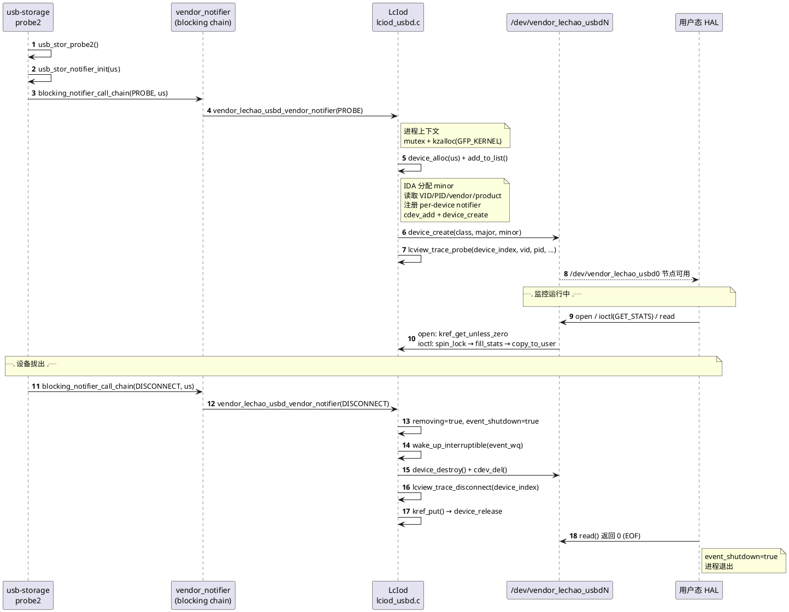
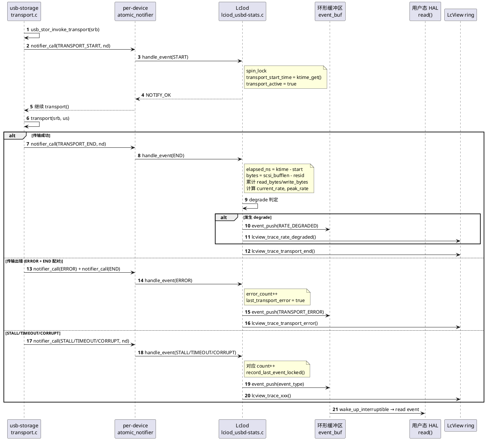
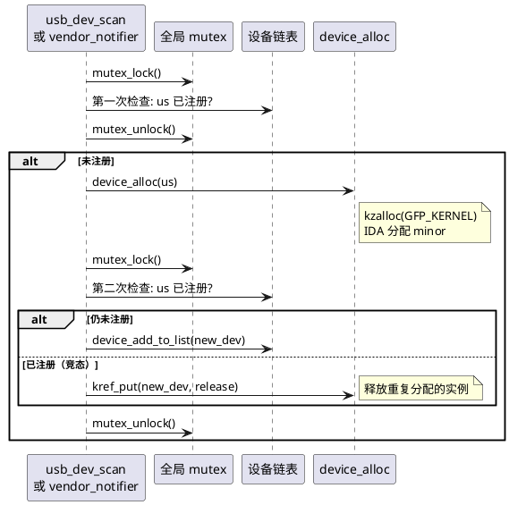
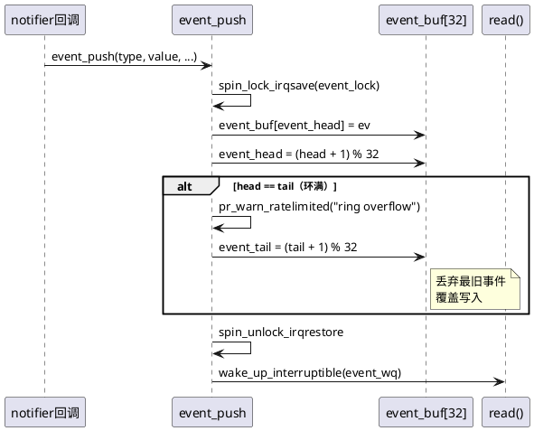
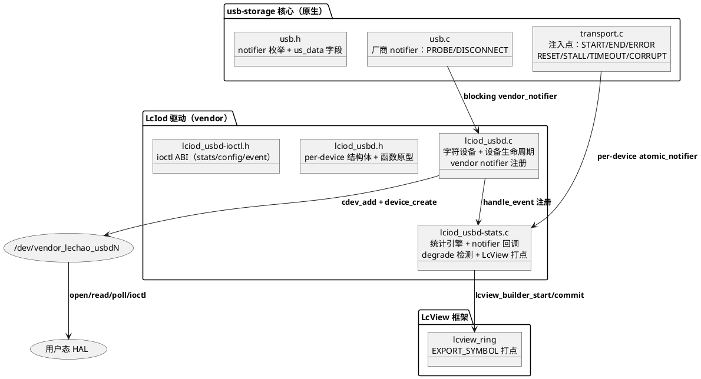
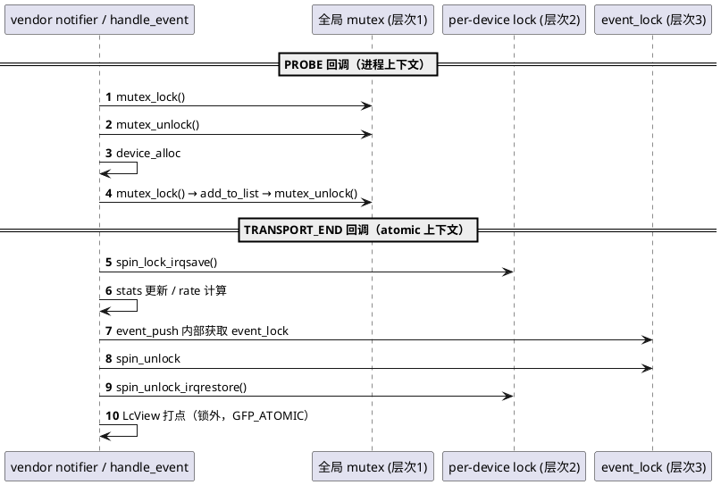
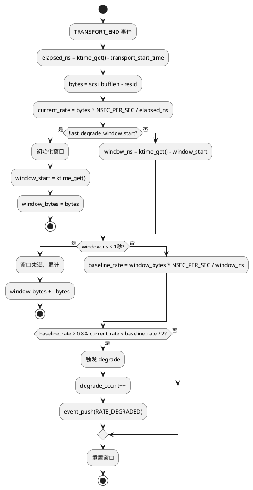
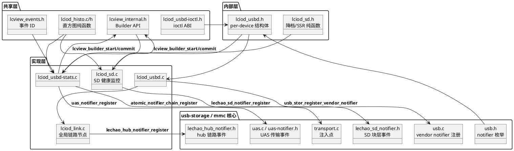
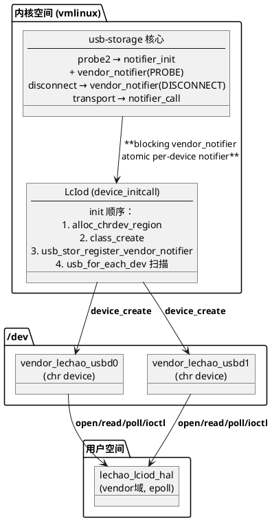
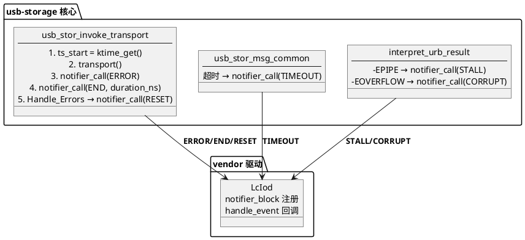

# LcIod 内核驱动

## 概述

LcIod 是**USB 存储速率监控驱动**的内核态组件，以 built-in 模式编译进 vmlinux，为每个 USB 存储设备创建独立的字符设备 `/dev/vendor_lechao_usbdN`（最多 16 个）。通过 notifier chain 机制从 usb-storage 核心实时捕获传输事件，计算速率、检测性能降级，并通过 ioctl 和 read() 向用户态提供统计快照和异步事件推送。

- **职责**：实时监控 USB 存储设备的传输速率、延迟、错误；自动检测性能降级；向用户态推送结构化事件
- **上下游**：上游为 usb-storage 核心（通过 notifier chain 接收传输事件）；下游为 LcView 打点框架（EXPORT_SYMBOL 调用）和用户态 HAL（通过字符设备读取统计和事件）
- **对外接口**：字符设备 `/dev/vendor_lechao_usbdN`（ioctl GET_STATS/SET_CONFIG、read 阻塞读事件）

**设计理念：** 通过 notifier chain 注入 usb-storage 核心，零侵入式捕获传输事件；per-device 多实例架构，每个 USB 设备独立监控；双重 notifier（厂商级 PROBE/DISCONNECT + per-device 传输事件）实现完整生命周期覆盖。

**设计目标：**

1. **Notifier chain 注入** — 零侵入式捕获 usb-storage 核心的传输事件，无需修改核心逻辑
2. **Per-device 多实例** — 每个 USB 存储设备独立字符设备，最多 16 个，IDA 分配次设备号
3. **实时统计引擎** — 累计读写字节数、命令数、错误数；计算瞬时速率和峰值速率
4. **Degrade 自动检测** — 1 秒滑动窗口对比基线速率，自动发现性能降级
5. **事件推送通道** — 环形缓冲区存储异常事件，阻塞 read() 支持异步通知
6. **LcView 打点集成** — 所有 PROBE/DISCONNECT/传输事件同步上送 LcView 时序分析

**源码路径：**

- 内核源码根目录：`~/workspace/rpi5-kernel-build/common`
- LcIod 模块源码：`vendor/lechao/LcIod/`
- 完整源码归档：[`../../code/rpi5/kernel/new/vendor/lechao/LcIod/`](../../code/rpi5/kernel/new/vendor/lechao/LcIod/)
- usb-storage 修改归档：[`../../code/rpi5/kernel/modified/drivers/usb/storage/`](../../code/rpi5/kernel/modified/drivers/usb/storage/)

> **关联文档：** LcView 打点框架设计见 [01.01-内核态增强-lcview-kernel.md](../01-打点增强/01.01-内核态增强-lcview-kernel.md)。系统级架构分析见 [README.md](./README.md)。

## 用例视图

### 正常路径：USB 设备生命周期（PROBE → 监控 → DISCONNECT）

从 USB 存储设备插入到监控实例创建再到设备拔出的完整流程：



### 正常路径：传输事件处理流程

从 usb-storage 核心发射传输事件到 LcIod 统计更新、degrade 检测、事件推送、LcView 打点的完整流程：



### 异常路径：设备热插拔竞态

模块初始化扫描与 vendor notifier 同时触发 PROBE，通过双重检查防止重复注册：



### 异常路径：环满溢出

事件环形缓冲区满时丢弃最旧事件：



## 逻辑视图

### 模块分解



**职责矩阵：**

| 模块 | 职责 | 关键抽象 |
|------|------|---------|
| `lciod_usbd.c` | 字符设备注册、设备生命周期管理、vendor notifier 注册 | `vendor_lechao_usbd_vendor_notifier` — [lciod_usbd.c:918](../../code/rpi5/kernel/new/vendor/lechao/LcIod/lciod_usbd.c#L918) |
| `lciod_usbd-stats.c` | notifier 回调、统计更新、degrade 检测、事件推送、LcView 打点 | `vendor_lechao_usbd_handle_event` — [lciod_usbd-stats.c:862](../../code/rpi5/kernel/new/vendor/lechao/LcIod/lciod_usbd-stats.c#L862) |
| `lciod_usbd.h` | per-device 结构体定义、跨编译单元函数原型 | `struct vendor_lechao_usbd_device` — [lciod_usbd.h:59](../../code/rpi5/kernel/new/vendor/lechao/LcIod/lciod_usbd.h#L59) |
| `lciod_usbd-ioctl.h` | 用户态共享 ABI：stats/config/event/link_stats/latency_histogram 结构体 + ioctl 命令码 | `struct vendor_lechao_usbd_stats` — [lciod_usbd-ioctl.h:78](../../code/rpi5/kernel/new/vendor/lechao/LcIod/lciod_usbd-ioctl.h#L78) |

### usb-storage notifier chain 注入

usb-storage 核心的 notifier chain 注入是 LcIod 实现零侵入式监控的关键设计。修改涉及三个文件：

#### usb.h 新增内容

[`usb.h.diff`](../../code/rpi5/kernel/modified/drivers/usb/storage/usb.h.diff) 新增：

**notifier 枚举（9 类事件）：**

```c
// usb.h.diff:45-55
enum usb_stor_notifier_event {
    USB_STOR_NOTIFIER_TRANSPORT_START,   /* 传输开始：R-16 P4 起停发（枚举保留兼容） */
    USB_STOR_NOTIFIER_TRANSPORT_END,     /* 传输结束 */
    USB_STOR_NOTIFIER_TRANSPORT_ERROR,   /* 传输层错误 */
    USB_STOR_NOTIFIER_RESET,             /* 设备重置 */
    USB_STOR_NOTIFIER_DEVICE_PROBE,      /* 设备探测 */
    USB_STOR_NOTIFIER_DEVICE_DISCONNECT, /* 设备断开 */
    USB_STOR_NOTIFIER_STALL,             /* USB STALL */
    USB_STOR_NOTIFIER_TIMEOUT,           /* 传输超时 */
    USB_STOR_NOTIFIER_DATA_CORRUPT,      /* 数据损坏 */
};
```

> 注：`RATE_DEGRADED` 是 vendor 驱动（LcIod）内部派生事件，不在核心 notifier 枚举中发射，由 `handle_event` 根据速率/延迟变化在锁内推送。

**notifier_data 结构体：**

```c
// usb.h.diff:73-81
struct usb_stor_notifier_data {
    struct us_data *us;            /* usb-storage 设备实例 */
    struct scsi_cmnd *srb;         /* SCSI 命令指针 */
    int result;                    /* 传输层返回码 */
    int status;                    /* URB 状态码 */
    u8 data_direction;             /* 数据方向 */
    u32 data_len;                  /* 请求传输长度 */
    u64 duration_ns;               /* 传输耗时（仅 TRANSPORT_END 填充） */
};
```

**us_data 新增字段：**

```c
// usb.h.diff:92-107
struct atomic_notifier_head notifier;  /* vendor 驱动注册的通知链头 */
int last_fault_type;                   /* 预留：最近 USB 传输故障类型（暂无消费者） */
int last_fault_status;                 /* 预留：最近故障 URB status（暂无消费者） */
u64 last_rate_sample_ns;               /* 预留：速率采样时间 */
u64 last_rate_sample_bytes;            /* 预留：速率采样字节数 */
```

> 注：`last_fault_type`/`last_fault_status` 当前仅由 transport.c 发射 notifier 时写入，内核内无读取点，故障上下文经 `usb_stor_notifier_data` 载荷传递给 vendor 驱动；两字段留作后续「最近一次故障」快照扩展，`last_rate_sample_*` 为速率采样预留（当前未使用）。

**helper 函数（inline）：** `usb_stor_notifier_init(us)`、`usb_stor_notifier_call(us, event, data)`、`usb_stor_register_vendor_notifier(nb)`、`usb_stor_unregister_vendor_notifier(nb)` — [usb.h.diff:124-154](../../code/rpi5/kernel/modified/drivers/usb/storage/usb.h.diff#L124)

#### usb.c 新增内容

[`usb.c.diff`](../../code/rpi5/kernel/modified/drivers/usb/storage/usb.c.diff) 新增厂商级 blocking notifier 链：

```c
// usb.c.diff:9-21
static BLOCKING_NOTIFIER_HEAD(usb_stor_vendor_nh);

int usb_stor_register_vendor_notifier(struct notifier_block *nb)
{
    return blocking_notifier_chain_register(&usb_stor_vendor_nh, nb);
}
EXPORT_SYMBOL_GPL(usb_stor_register_vendor_notifier);
```

probe2 中初始化 + 通知；disconnect 中通知。见 [usb.c.diff:31-49](../../code/rpi5/kernel/modified/drivers/usb/storage/usb.c.diff#L31)。

#### transport.c 新增内容

[`transport.c.diff`](../../code/rpi5/kernel/modified/drivers/usb/storage/transport.c.diff) 新增 7 类事件注入点、实际共 11 个 `usb_stor_notifier_call()` 调用点（`START` 枚举保留但 R-16 P4 起核心侧已停发，不再调用）：

| 注入点 | 位置 | 事件类型 | 说明 |
|--------|------|---------|------|
| TRANSPORT_START | `usb_stor_invoke_transport` 入口 | `START` | **R-16 P4 起停发**（枚举保留兼容，`ts_start` 仅用于计算 `duration_ns` 随 END 携带） |
| TRANSPORT_END | 所有出口点（正常/aborted/error/no_sense） | `END` | 成功/失败/auto-sense 路径，共 4 处调用 |
| TRANSPORT_ERROR | `USB_STOR_TRANSPORT_ERROR` 分支 | `ERROR` | transport() 返回 ERROR |
| RESET | `Handle_Errors` 标签 | `RESET` | 错误恢复路径 |
| STALL | `interpret_urb_result` (-EPIPE) | `STALL` | 端点挂起，共 3 处调用（control pipe + clear_halt 失败/成功） |
| TIMEOUT | `usb_stor_msg_common` 超时 | `TIMEOUT` | URB 等待超时或被信号中断。**CXX-004**：须在 `usb_kill_urb` 前快照 `URB status`（kill 完成后 status 变为 -ENOENT/-ECONNRESET，无法区分真超时与主动取消）；真超时（`timeleft == 0`）显式上报 `-ETIMEDOUT`，信号中断保留 kill 前快照值 |
| DATA_CORRUPT | `interpret_urb_result` (-EOVERFLOW) | `CORRUPT` | Babble/数据损坏 |

#### uas.c 新增内容

UAS 协议栈（`drivers/usb/storage/uas.c`）与 usb-storage BOT 平行接入同一套 vendor notifier：复用一个全局 blocking 厂商链 `uas_vendor_nh`（PROBE/DISCONNECT 生命周期）与 per-device `devinfo->notifier` 原子链（传输事件），接口在 [`uas-notifier.h`](../../code/rpi5/kernel/new/drivers/usb/storage/uas-notifier.h) 定义，由 [`uas.c.diff`](../../code/rpi5/kernel/modified/drivers/usb/storage/uas.c.diff) 注入：

| 注入点 | 位置 | 事件类型 | 说明 |
|--------|------|---------|------|
| TRANSPORT_START | `uas_queuecommand_lck`（tag 分配 + URB 成功提交后） | `START` | 命令进入 UAS 传输生命周期，`duration_ns` 由 LcIod 侧用 START/END 时间戳差值计算 |
| TRANSPORT_END | `uas_try_complete`（命令收尾唯一汇聚点，`scsi_done` 之前） | `END` | 携带最终 `result/status`，持 `devinfo->lock` 原子上下文 |
| TRANSPORT_ERROR | `uas_stat_cmplt`（状态 URB 上报错误，srb=NULL）/ `uas_data_cmplt`（数据 URB 失败）/ `uas_eh_abort_handler`（abort，-ECANCELED） | `ERROR` | 传输层异常，通知监控驱动记录 |
| RESET | `uas_eh_device_reset_handler`（`usb_reset_device` 成功后） | `RESET` | 仅上报成功的 device reset |
| DEVICE_PROBE / DEVICE_DISCONNECT | `uas_probe` / `uas_scan_work`（rescan 补发）/ `uas_disconnect`（teardown 前） | 厂商链 | probe/disconnect 经 `uas_vendor_nh` blocking 链广播 |

> **本批行为变更**：移除了 `uas_zap_pending` 中为被 reset/disconnect 清空的 pending 命令补发 `TRANSPORT_END` 的逻辑——这些命令未走正常状态机 END 路径，补发会与 `uas_try_complete` 的正常 END 构成重复收尾。移除后 `TRANSPORT_END` 仅由 `uas_try_complete` 单点发射，每条命令最多一次收尾通知。

**为什么用 notifier chain 而非直接 hook：**

1. **零侵入**：notifier chain 是内核标准机制，通过注册回调实现扩展，无需修改核心逻辑流程
2. **解耦**：vendor 驱动独立编译，usb-storage 核心无需感知 vendor 模块的存在
3. **可扩展**：多个 vendor 驱动可同时注册到同一 notifier 链，按优先级执行
4. **上下文安全**：atomic_notifier_chain 在任意上下文安全调用，blocking_notifier_chain 在进程上下文调用

> 完整 diff：[`usb.h.diff`](../../code/rpi5/kernel/modified/drivers/usb/storage/usb.h.diff)（156 行）、[`usb.c.diff`](../../code/rpi5/kernel/modified/drivers/usb/storage/usb.c.diff)（53 行）、[`transport.c.diff`](../../code/rpi5/kernel/modified/drivers/usb/storage/transport.c.diff)（241 行）、[`uas.c.diff`](../../code/rpi5/kernel/modified/drivers/usb/storage/uas.c.diff)（270 行）

### ioctl ABI（跨层共享契约）

用户态与内核态共享的数据结构定义在 [`lciod_usbd-ioctl.h`](../../code/rpi5/kernel/new/vendor/lechao/LcIod/lciod_usbd-ioctl.h)。当前 ABI 版本 `VENDOR_LECHAO_USBD_ABI_VERSION = 5`（v4 追加链路事件/`link_stats`/`GET_LINK_STATS`；v5 追加延迟直方图/`GET_LATENCY_HISTOGRAM`）；本头文件为内核-用户态共享 ABI 真相源，AOSP HAL 与 usb-verify 的镜像副本必须 1:1 同步。

#### struct vendor_lechao_usbd_stats

30 个业务字段（另含 `reserved[2]` 对齐填充；`protocol` 由原 `reserved[0]` 语义化而来，R1 UAS 零 ABI bump 扩展），分为四类 — [lciod_usbd-ioctl.h:78-110](../../code/rpi5/kernel/new/vendor/lechao/LcIod/lciod_usbd-ioctl.h#L78)

| 字段分类 | 字段列表 | 说明 |
|---------|---------|------|
| 累计计数器 | `read_bytes`, `write_bytes`, `read_ns`, `write_ns`, `read_cmds`, `write_cmds`, `error_count`, `reset_count`, `probe_count`, `disconnect_count`, `degrade_count`, `stall_count`, `corrupt_count`, `timeout_count`, `event_drop_count`, `read_error_count`, `write_error_count` | 单调递增，RESET_STATE 清零；`event_drop_count` 为 ABI v2 新增（环形缓冲区溢出丢弃计数），`read/write_error_count` 为 ABI v3 新增（读/写方向错误事件计数） |
| 快照字段 | `current_rate`, `peak_rate`, `last_transport_latency_ns`, `last_event_ts_ns`, `last_event_type`, `last_update` | 反映最近一次传输/事件状态 |
| 设备标识 | `vid (u16)`, `pid (u16)`, `protocol (u8)`, `vendor[32]`, `product[32]` | 分配时读取，之后不变；`protocol` 为 R1 UAS 零 ABI bump 扩展（BOT=0/UAS=1） |
| 配置状态 | `enabled (u8)`, `flags (u32)` | 反映当前运行时配置 |

#### struct vendor_lechao_usbd_config

| 字段 | 类型 | 说明 |
|------|------|------|
| `enabled` | `u8` | 监控开关：1=启用, 0=暂停 |
| `reserved` | `u8[3]` | 预留对齐 |
| `flags` | `u32` | 运行时标志位 |

#### struct vendor_lechao_usbd_event

ABI v3（R-14）11 字段 — [lciod_usbd-ioctl.h:231-245](../../code/rpi5/kernel/new/vendor/lechao/LcIod/lciod_usbd-ioctl.h#L231)：

| 字段 | 类型 | 说明 |
|------|------|------|
| `timestamp_ns` | `u64` | 事件时间（CLOCK_MONOTONIC 纳秒） |
| `event_type` | `u32` | 事件类型（见 enum） |
| `event_value` | `u32` | 附加值（TRANSPORT_ERROR 为 result 码；RATE_DEGRADED 为当前速率） |
| `status` | `s32` | 原始错误码（STALL 为 -EPIPE，TIMEOUT 为 URB status；RATE_DEGRADED 为降级阈值速率） |
| `data_direction` | `u8` | 传输方向：0=无, 1=读, 2=写 |
| `valid` | `u8` | 有效标志 |
| `reserved` | `u8[2]` | 预留对齐 |
| `wall_time_ns` | `u64` | v3：事件发生时间（CLOCK_REALTIME 墙钟纳秒），与 timestamp_ns（mono）双时间戳供跨源关联 |
| `opcode` | `u32` | v3：SCSI 操作码（srb->cmnd[0]），无可得命令上下文时为 0 |
| `lba` | `u64` | v3：SCSI 起始逻辑块地址；RATE_DEGRADED 复用为降级基线速率 |
| `bytes` | `u32` | v3：本次传输有效字节数；RATE_DEGRADED 为 0 |
| `retry` | `u8` | v3：命令重试次数（srb->retries） |
| `reserved2` | `u8[3]` | 预留对齐 |

> **字节序契约（LCD-004/KRN-002）：** 本结构内核与用户态同机同序（ARM64 LE）裸传输——`read()` 直接 `copy_to_user` 整个 struct，无逐字段序列化。`lciod_usbd-ioctl.h` 内编译守卫保证大端环境直接编译失败（`#error`，[`lciod_usbd-ioctl.h:227-230`](../../code/rpi5/kernel/new/vendor/lechao/LcIod/lciod_usbd-ioctl.h#L227)）；内核与用户态双侧同步禁止单侧修改布局（CXX-001）。

#### enum vendor_lechao_usbd_event_type

```c
// lciod_usbd-ioctl.h:197-208
enum vendor_lechao_usbd_event_type {
    VENDOR_LECHAO_USBD_EVENT_NONE            = 0,  /* 无事件（初始状态） */
    VENDOR_LECHAO_USBD_EVENT_TRANSPORT_ERROR = 1,  /* USB 传输层错误 */
    VENDOR_LECHAO_USBD_EVENT_STALL           = 2,  /* USB STALL（-EPIPE） */
    VENDOR_LECHAO_USBD_EVENT_DATA_CORRUPT    = 3,  /* 数据损坏（-EOVERFLOW） */
    VENDOR_LECHAO_USBD_EVENT_TIMEOUT         = 4,  /* 传输超时 */
    VENDOR_LECHAO_USBD_EVENT_RESET           = 5,  /* 设备重置 */
    VENDOR_LECHAO_USBD_EVENT_RATE_DEGRADED   = 6,  /* 性能降级 */
    VENDOR_LECHAO_USBD_EVENT_LINK_CONNECT     = 7, /* v4：链路连接/枚举成功 */
    VENDOR_LECHAO_USBD_EVENT_LINK_DISCONNECT  = 8, /* v4：链路断开/掉线（event_value 为原因分类） */
    VENDOR_LECHAO_USBD_EVENT_LINK_OVERCURRENT = 9, /* v4：端口过流（bytes 为过流计数） */
};
```

> `LINK_*`（7/8/9）为 ABI v4 新增，由全局链路节点 `lciod_link` 订阅 hub notifier 后转事件流发射（掉线原因/枚举失败阶段分类见 `lciod_link.h` 的 `lciod_link_disconnect_reason`/`lciod_link_enum_stage`）；`event_value` 为掉线原因/枚举失败阶段细码，`opcode` 高 16 位为 busnum、低 16 位为 port，`lba` 为事件时长，`bytes` 为过流计数/枚举耗尽重试次数。

#### struct vendor_lechao_usbd_link_stats（v4）

通过 `GET_LINK_STATS` 返回的全局链路事件统计快照，对应 `lciod_link` 全局链路节点 — [lciod_usbd-ioctl.h:124-139](../../code/rpi5/kernel/new/vendor/lechao/LcIod/lciod_usbd-ioctl.h#L124)：

| 字段 | 类型 | 说明 |
|------|------|------|
| `connect_count` | `u64` | 累计：链路连接/枚举成功次数 |
| `disconnect_count` | `u64` | 累计：链路断开/掉线次数 |
| `enum_fail_count` | `u64` | 累计：枚举失败次数 |
| `overcurrent_count` | `u64` | 累计：端口过流次数 |
| `last_event_ts_ns` | `u64` | 最近一次链路事件 mono 时间戳 |
| `last_event_type` | `u32` | 最近一次事件类型 |
| `last_busnum` / `last_port` | `u16` | 最近一次事件 busnum / port（1 起） |
| `last_vid` / `last_pid` | `u16` | 最近一次事件 VID / PID |
| `last_err` | `s32` | 最近一次事件错误码 |
| `last_count` | `u32` | 最近一次事件计数（过流计数/枚举耗尽重试次数） |
| `last_duration_ns` | `u64` | 最近一次事件时长 |
| `reserved` | `u8[8]` | 预留对齐 |

#### struct vendor_lechao_usbd_latency_histogram（v5）

通过 `GET_LATENCY_HISTOGRAM` 返回的传输延迟/块大小二维直方图快照。维度编译期固定为 2 方向 × 8 块大小档 × 12 延迟档（`HISTO_DIRS`/`HISTO_SIZE_BINS`/`HISTO_LAT_BINS`），由 USB `transport_end` 与 SD `COMPLETE` 双链接入，仅持锁累加、快照锁内拷贝，`RESET_STATE` 清零 — [lciod_usbd-ioctl.h:145-169](../../code/rpi5/kernel/new/vendor/lechao/LcIod/lciod_usbd-ioctl.h#L145)：

| 字段 | 类型 | 说明 |
|------|------|------|
| `mono_ts_ns` | `u64` | 快照时戳（CLOCK_MONOTONIC 纳秒） |
| `dirs` / `size_bins` / `latency_bins` | `u32` | 方向数 / 块大小档数 / 延迟档数 |
| `reserved` | `u32` | 预留对齐 |
| `size_bounds[8]` | `u64` | 块大小档上界（字节，末档饱和） |
| `latency_bounds[12]` | `u64` | 延迟档上界（纳秒，末档饱和） |
| `counts[2][8][12]` | `u32` | 累计矩阵 `[dir][size][lat]`（dir 0=读/1=写） |

> 档位上界与入桶纯函数由 `lciod_histo.c/h` 提供（无内核依赖，内核与 host 单测共用）：块大小档上界 512B/4KiB/16KiB/64KiB/256KiB/1MiB/8MiB/饱和；延迟档上界 1µs/5µs/10µs/50µs/100µs/500µs/1ms/5ms/10ms/50ms/100ms/饱和。

#### ioctl 命令码

魔数 `'R'`，定义在 [lciod_usbd-ioctl.h:289-334](../../code/rpi5/kernel/new/vendor/lechao/LcIod/lciod_usbd-ioctl.h#L289)：

| 命令 | 方向 | 参数 | 功能 |
|------|------|------|------|
| `GET_STATS` (cmd 0) | 内核→用户 | `struct vendor_lechao_usbd_stats` | 返回统计快照 |
| `RESET_STATE` (cmd 1) | 无 | 无 | 重置累计计数器 |
| `GET_CONFIG` (cmd 2) | 内核→用户 | `struct vendor_lechao_usbd_config` | 读取配置 |
| `SET_CONFIG` (cmd 3) | 用户→内核 | `struct vendor_lechao_usbd_config` | 修改配置 |
| `GET_LINK_STATS` (cmd 4, v4) | 内核→用户 | `struct vendor_lechao_usbd_link_stats` | 返回全局链路统计快照 |
| `GET_LATENCY_HISTOGRAM` (cmd 5, v5) | 内核→用户 | `struct vendor_lechao_usbd_latency_histogram` | 返回延迟/块大小直方图快照 |

#### 环形缓冲区大小

`VENDOR_LECHAO_USBD_EVENT_BUF_SIZE = 32`，每个设备的事件队列深度为 32 条，覆盖典型突发异常场景。

## 过程视图

### 并发模型

LcIod 采用三重锁层次防止死锁：



**三重锁层次（按获取顺序）：**

| 锁 | 类型 | 保护对象 | 获取上下文 |
|----|------|---------|-----------|
| `vendor_lechao_usbd_mutex` | mutex | 全局设备链表 | 进程上下文（PROBE/DISCONNECT/scan） |
| `rate_dev->lock` | spinlock (irqsave) | stats、config、transport 状态 | atomic notifier 回调 |
| `rate_dev->event_lock` | spinlock (irqsave) | event_buf、head、tail | notifier 回调、read() |

死锁预防：先获取外层锁（mutex），再获取内层锁（spinlock）。不存在反向获取路径：spinlock 上下文不会尝试获取 mutex。

### Atomic 上下文安全

notifier chain 调用链上下文分析：

```
blocking_notifier_call_chain (进程上下文, usb.c)
  └── vendor_lechao_usbd_vendor_notifier (进程上下文)
        ├── mutex_lock (可睡眠)
        ├── kzalloc(GFP_KERNEL) (可睡眠)
        └── device_create (可睡眠)

atomic_notifier_call_chain (任意上下文, transport.c)
  └── vendor_lechao_usbd_handle_event (atomic 上下文)
        ├── spin_lock_irqsave (不可睡眠)
        ├── stats 更新 + event_push (不可睡眠)
        ├── spin_unlock_irqrestore
        └── lcview_builder_start (GFP_ATOMIC, 可失败)
```

关键约束：
- `handle_event` 运行在 atomic notifier chain，不可调用睡眠函数
- `spin_lock_irqsave` 禁用本地 CPU 中断，防止中断上下文死锁
- LcView 打点在 `spin_unlock` 后调用，允许使用 GFP_ATOMIC

### Degrade 检测算法

使用 1 秒滑动窗口对比历史基线速率与当前瞬时速率：



**阈值设计（2x）考量：** USB 传输速率本身有波动（±30% 正常），2 倍阈值过滤正常抖动，只捕获真正性能问题（USB 2.0 降级到 Full Speed、线缆接触不良、电源不稳定）。

**两种 degrade 判定条件**（源码 [lciod_usbd-stats.c:681-709](../../code/rpi5/kernel/new/vendor/lechao/LcIod/lciod_usbd-stats.c#L681)）：

```c
// lciod_usbd-stats.c:681-709
u64 prev_rate = rate_dev->stats.current_rate;
u64 prev_latency = rate_dev->last_transport_latency_ns;

vendor_lechao_usbd_update_current_rate_locked(rate_dev, bytes, elapsed_ns);

/* KRN-005：瞬时判定加 10% 幅度阈值（速率/延迟双向） */
if (prev_rate > 0 &&
    rate_dev->stats.current_rate < prev_rate - prev_rate / 10)
    degraded = true;
if (prev_latency > 0 &&
    elapsed_ns > prev_latency + prev_latency / 10)
    degraded = true;
```

- 速率下降：`current_rate < prev_rate - prev_rate / 10`（KRN-005：降幅超 10% 才判定）
- 延迟上升：`elapsed_ns > prev_latency + prev_latency / 10`（KRN-005：增幅超 10% 才判定）

KRN-005 说明：原实现任意幅度下降/上升即 degraded，而 USB 命令速率逐条波动（±30% 正常），条件几乎恒真——每命令都推送 RATE_DEGRADED 事件 + trace，I/O 洪水时 WARN 级事件挤占 ring 驱逐正常记录。真实降级由滑动窗口判定（1s 窗口 + 2 倍阈值）兜底，瞬时判定仅作快速告警，10% 阈值过滤正常抖动。

滑动窗口验证作为辅助判定，确保持续下降而非瞬时波动。

### 关键不变量

| 不变量 | 保证机制 | 代码位置 |
|--------|---------|---------|
| 设备不重复注册 | 双重检查（mutex 外 + mutex 内） | [`lciod_usbd.c:918`](../../code/rpi5/kernel/new/vendor/lechao/LcIod/lciod_usbd.c#L918) |
| kref 归零时才释放 | `kref_put` + `device_release` 回调 | [`lciod_usbd.c:565`](../../code/rpi5/kernel/new/vendor/lechao/LcIod/lciod_usbd.c#L565) |
| removing 标志原子访问 | `READ_ONCE`/`WRITE_ONCE` | [`lciod_usbd.c:191`](../../code/rpi5/kernel/new/vendor/lechao/LcIod/lciod_usbd.c#L191) |
| START/END 配对 | ERROR 后立即发射 END | [`transport.c.diff:186-187`](../../code/rpi5/kernel/modified/drivers/usb/storage/transport.c.diff#L186) |
| 环满时丢弃最旧 | head == tail 时 tail 推进（逻辑抽至 `lciod_event_ring_push` 纯函数） | [`lciod_usbd-stats.c:538-547`](../../code/rpi5/kernel/new/vendor/lechao/LcIod/lciod_usbd-stats.c#L538) |
| `lcview_trace_*` 字段完整性 | 任一 add 失败整体丢弃事件（KRN-016），防用户态 schema 解析错位 | [`lciod_usbd.c:74-113`](../../code/rpi5/kernel/new/vendor/lechao/LcIod/lciod_usbd.c#L74) |

## 开发视图

### 文件职责矩阵

> **约束：** 目录结构只列出源码文件，不含编译产物（`.o`、`.ko`、`.cmd` 等）。

```
code/rpi5/kernel/new/vendor/lechao/LcIod/
├── lciod_usbd.c           # 字符设备 + 设备生命周期 + vendor notifier
├── lciod_usbd-stats.c     # 统计引擎 + notifier 回调 + degrade 检测 + LcView 打点
├── lciod_link.c           # 全局链路节点（hub notifier → LINK_* 事件 + GET_LINK_STATS）
├── lciod_link.h           # 链路节点接口 + 掉线/枚举分类 + 事件打包
├── lciod_sd.c             # SD/MMC 块层健康监控（10s 窗聚合 + STUCK 降档 + sysfs）
├── lciod_sd.h             # 剥位/降档/SSR 解码纯函数（内核与 host 单测共用）
├── lciod_histo.c          # 延迟/块大小二维直方图纯函数（USBD 与 SD 共用）
├── lciod_histo.h          # 直方图维度/档位上界/入桶接口
├── lciod_read_logic.c     # read 排空判定纯函数（shutdown/EOF 四象限，内核与 host 单测共用）
├── lciod_read_logic.h     # 纯函数声明（不依赖内核 API）
├── lciod_usbd.h           # per-device 结构体 + 函数原型
├── lciod_usbd-ioctl.h     # 用户态共享 ABI（stats/config/event/link_stats/latency_histogram + ioctl 命令码）
├── Kconfig                # CONFIG_VENDOR_LECHAO_USBD / VENDOR_LECHAO_SD_MON bool
├── Makefile               # lciod_usbd-objs / lciod_histo.o / lciod_sd.o
└── tests/                 # host 单测（read_logic / histo / sd + Makefile，一致性 gate）
```

| 文件 | 职责 | 关键函数 | 行数 |
|------|------|---------|------|
| `lciod_usbd.c` | 字符设备注册、设备生命周期、vendor notifier | `vendor_lechao_usbd_vendor_notifier`、`vendor_lechao_usbd_monitor_init` | 1428 |
| `lciod_usbd-stats.c` | notifier 回调、统计更新、degrade 检测、直方图入桶 | `vendor_lechao_usbd_handle_event`、`vendor_lechao_usbd_update_degrade_context_locked` | 1163 |
| `lciod_link.c` | 全局链路节点：hub notifier 回调、LINK_* 事件流、GET_LINK_STATS | `lciod_link_init`、`lciod_link_notifier` | 405 |
| `lciod_link.h` | 链路节点接口 + 掉线/枚举分类 + `lciod_link_pack_event` 纯函数 | `lciod_link_pack_event` | 153 |
| `lciod_sd.c` | SD/MMC 块层健康监控：10s 窗聚合上报、STUCK 逐级剥 caps 降档、sysfs | `lciod_sd_notifier`、`lciod_sd_downgrade` | 546 |
| `lciod_sd.h` | 剥位/降档/SSR 解码纯函数（内核与 host 单测共用） | `lciod_sd_next_lower_speed`、`lciod_sd_strip_modes_above` | 126 |
| `lciod_histo.c` | 延迟/块大小二维直方图纯函数（内核 API 剥离） | `lciod_histo_add`、`lciod_histo_size_bucket` | 64 |
| `lciod_histo.h` | 直方图维度/档位上界/入桶接口 | `struct lciod_histo` | 76 |
| `lciod_read_logic.c` | read 排空判定纯函数（内核 API 剥离） | `lciod_nonblock_read_decision` | 41 |
| `lciod_read_logic.h` | 纯函数声明（内核与 host 单测共用） | — | 69 |
| `lciod_usbd.h` | per-device 结构体、函数原型 | `struct vendor_lechao_usbd_device` | 204 |
| `lciod_usbd-ioctl.h` | ioctl ABI 定义 | `struct vendor_lechao_usbd_stats` | 336 |
| `tests/lciod_read_logic_host_test.c` | read 排空判定 host 单测（四象限语义） | `main` | 127 |
| `tests/lciod_histo_host_test.c` | 直方图桶边界/饱和 host 单测 | `main` | 216 |
| `tests/lciod_sd_host_test.c` | 剥位/降档/SSR 解码 host 单测 | `main` | 144 |
| `tests/Makefile` | host 单测编译运行入口 | — | 25 |

### 模块依赖图



### 构建集成

#### Kconfig / Makefile

> 完整定义：[`Kconfig`](../../code/rpi5/kernel/new/vendor/lechao/LcIod/Kconfig)，[`Makefile`](../../code/rpi5/kernel/new/vendor/lechao/LcIod/Makefile)

| 配置项 | 值 | 说明 |
|--------|-----|------|
| `config VENDOR_LECHAO_USBD` | `bool` | built-in 模式，`default y`（默认编译进内核） |
| `depends on` | `VENDOR_LECHAO` / `USB_STORAGE=y` / `USB_UAS=y` | 统一门控 + 强制 built-in，避免模块依赖导致 LcIod 不可用 |
| `select` | `LCVIEW` | 自动启用 LcView |
| `config VENDOR_LECHAO_SD_MON` | `bool` | SD/MMC 块层健康监控独立开关，`depends on VENDOR_LECHAO` / `LCVIEW` / `MMC_BLOCK=y`，`default y` |
| `obj-$(CONFIG_VENDOR_LECHAO_USBD)` | `lciod_usbd.o` | 目标文件 |
| `lciod_usbd-objs` | `lciod_usbd.o lciod_usbd-stats.o lciod_read_logic.o lciod_link.o` | 编译单元 |
| `obj-$(CONFIG_VENDOR_LECHAO)` | `lciod_histo.o` | 直方图纯函数（USBD 与 SD 共用，单独编译防重复符号） |
| `obj-$(CONFIG_VENDOR_LECHAO_SD_MON)` | `lciod_sd.o` | SD/MMC 健康监控目标文件 |

host 单测构建执行（与 LcView 同构，S8 一致性 gate——纯逻辑改动须 `make -C tests` 通过）：

```bash
cd ~/workspace/rpi5-kernel-build/common/vendor/lechao/LcIod/tests
make test    # 编译 lciod_read_logic_host_test 并执行（shutdown/EOF 四象限语义）
```

```bash
cd ~/workspace/rpi5-kernel-build/common
make ARCH=arm64 CROSS_COMPILE=aarch64-linux-gnu- menuconfig
# Device Drivers → Vendor Lechao → Lechao USB Storage Rate Monitor → Y
make ARCH=arm64 CROSS_COMPILE=aarch64-linux-gnu- Image
```

## 部署视图

### 运行时拓扑



### 权限与安全

| 配置项 | 文件 | 说明 |
|--------|------|------|
| 设备节点权限 | [`lciod_usbd.c:132`](../../code/rpi5/kernel/new/vendor/lechao/LcIod/lciod_usbd.c#L132) | `devnode` 设置 0600（R-11 收紧：仅 daemon/HAL 通过 sepolicy 放行访问，防任意进程读传输状态） |
| ueventd | `ueventd.rpi5.rc` | 可添加 `/dev/vendor_lechao_usbd* 0600` |
| SELinux 设备类型 | `file_contexts` | `vendor_lechao_usbd_device` 标签 |

### 验证

```bash
# 验证设备节点
ls -l /dev/vendor_lechao_usbd*
# 期望: /dev/vendor_lechao_usbd0 ... /dev/vendor_lechao_usbdN (0666)

# 查看内核日志
dmesg | grep vendor_lechao_usbd
# 期望: registered device vendor_lechao_usbd0 (VID:xxxx PID:xxxx)
```

## 关键设计与实现

本章节从架构与源码两个维度，提炼 LcIod 中的 9 项关键设计决策及其实现细节。

### Notifier chain 注入设计 — usb-storage 核心事件推送

**设计思路：** 通过修改 usb-storage 核心头文件和传输层源码，在关键传输节点插入 notifier_call 调用，将传输事件推送到 vendor 驱动。零侵入式设计，usb-storage 核心逻辑流程不变。



**源码实现：** transport.c 入口记录 `ts_start`（仅用于计算 `duration_ns` 随 END 携带，R-16 P4 起不再发射 START），所有出口点发射 END，ERROR 后紧跟 END 配对：

```c
// transport.c.diff:127-137
ts_start = ktime_get();   /* 仅用于下方 duration_ns 计算，不发 START notifier */
...
transport_duration_ns = ktime_to_ns(ktime_sub(ktime_get(), ts_start));

// transport.c.diff:186-187 (error 路径)
usb_stor_notifier_call(us, USB_STOR_NOTIFIER_TRANSPORT_ERROR, &notif_data);
usb_stor_notifier_call(us, USB_STOR_NOTIFIER_TRANSPORT_END, &notif_data);
```

### Per-device 多实例 — IDA 分配 + kref 引用计数

**设计思路：** 每个 USB 存储设备对应独立的监控实例，通过 IDA 分配次设备号（0~15），通过 kref 引用计数确保 fd 持有期间设备安全释放。IDA 可回收释放的次设备号，避免频繁插拔后无限增长；kref 解决"谁最后 close 谁清理"的问题。

```c
// lciod_usbd.c:593-617
rate_dev = kzalloc(sizeof(*rate_dev), GFP_KERNEL);
minor = ida_alloc_max(&vendor_lechao_usbd_ida, VENDOR_LECHAO_USBD_MAX_DEVICES - 1, GFP_KERNEL);
rate_dev->minor = minor;
kref_init(&rate_dev->kref);

// lciod_usbd.c:626-630 (错误路径：kref 初始化前需手动 ida_free)
if (!us->pusb_dev) {
    ida_free(&vendor_lechao_usbd_ida, minor);
    kfree(rate_dev);
    return ERR_PTR(-ENODEV);
}

// lciod_usbd.c:565
void vendor_lechao_usbd_device_release(struct kref *kref)
{
    struct vendor_lechao_usbd_device *rate_dev = container_of(kref, ...);
    ida_free(&vendor_lechao_usbd_ida, rate_dev->minor);
    kfree(rate_dev);
}
```

生命周期：`device_alloc` 初始化 kref=1 → `open()` kref_get → USB 断开 kref_put（但 fd 仍持有，引用>0）→ `close()` kref_put → 引用归零触发 `device_release`（ida_free + kfree）。注意：kref 初始化前的错误路径（如 `!us->pusb_dev`）必须手动 `ida_free`，因为此时 kref 尚未就绪，不会走 release 回调。

### 三重锁层次 — 死锁预防设计

**设计思路：** 按固定顺序获取锁：全局 mutex → per-device lock → event_lock。不存在反向获取路径，彻底防止死锁。详见 [过程视图 · 并发模型](#并发模型)。

| 锁层次 | 锁类型 | 保护对象 | 获取者 |
|--------|--------|---------|--------|
| 1 | `vendor_lechao_usbd_mutex` | 设备链表 | vendor_notifier、usb_dev_scan |
| 2 | `rate_dev->lock` | stats、config、transport 状态 | handle_event |
| 3 | `rate_dev->event_lock` | event_buf | event_push、read |

关键：`event_push` 内部获取 event_lock（层次 3），层次 2 + 3 嵌套但顺序固定。LcView 打点在所有锁释放后执行。

### 事件环形缓冲区 — 定长记录 + wait_queue

**设计思路：** 每个设备内嵌 32 条定长事件环形缓冲区，spinlock 保护写入，wait_queue 实现阻塞读取。满时丢弃最旧事件（head 追上 tail 时 tail 推进）。read() 端通过 `wait_event_interruptible` 阻塞等待，event_shutdown 标志实现优雅关闭（返回 EOF）。

- **KRN-004 shutdown 不越过非空判定**：断连后 ring 中可能仍有未消费的尾部事件，read() 先 drain 这些事件（返回事件）、ring 清空后才返回 0 (EOF)——判定逻辑抽至 `lciod_read_logic.c`（`lciod_nonblock_read_decision` 纯函数，host 单测覆盖四象限语义：返回 1→`-EAGAIN` 空环重试、0→0 EOF、-1→非空 drain，[`lciod_usbd.c:295`](../../code/rpi5/kernel/new/vendor/lechao/LcIod/lciod_usbd.c#L295)）
- **KRN-009 copy_to_user 失败回滚 event_tail**：read 取出事件后 `copy_to_user` 失败时回滚 `event_tail`，事件留在环中供下次重试而非丢失（[`lciod_usbd.c:301-316`](../../code/rpi5/kernel/new/vendor/lechao/LcIod/lciod_usbd.c#L301)；LCD-008 单读者下回滚不会导致重复投递给其他读者；回滚带守卫 `lciod_event_tail_rollback_ok`——期间写者驱逐推进 tail 时不再回滚，防 tail==head 判空致事件清零/重复消费）
- **LCD-008 单读者消费语义**：`event_tail` 是 per-device 共享状态，多读者并发 open 时构成共享消费队列（每条事件被随机分配给其中一个读者，不复制不回放）。当前实际单读者由 sepolicy 保证（`lechao_lciod_hal_device` 的 chr_file 访问仅授予 HAL domain，[`lciod_usbd.c:178-185`](../../code/rpi5/kernel/new/vendor/lechao/LcIod/lciod_usbd.c#L178)）；若未来出现多读者需求，须改为 per-fd 消费位或事件复制，不能依赖现有语义

### Degrade 滑动窗口检测 — 速率降级自动发现

**设计思路：** 1 秒滑动窗口对比历史基线速率与当前瞬时速率，2 倍阈值过滤正常波动。两种瞬时判定条件（KRN-005，均加 10% 幅度阈值过滤正常抖动）：速率下降超 10%（`current_rate < prev_rate - prev_rate / 10`）或延迟上升超 10%（`elapsed_ns > prev_latency + prev_latency / 10`）。滑动窗口验证作为辅助判定，确保持续下降而非瞬时波动。详见 [过程视图 · Degrade 检测算法](#degrade-检测算法)。

### Atomic 上下文安全 — notifier 回调约束

**设计思路：** handle_event 运行在 atomic notifier chain，必须使用 `spin_lock_irqsave` 禁用中断，不能调用睡眠函数。LcView 打点在 `spin_unlock` 后调用，使用 GFP_ATOMIC。

关键设计：**事件推送（`event_push`）和 LcView 打点是分离的**（`spin_unlock` 后才打点）。这是因为 `lcview_builder_start` 内部使用 `GFP_ATOMIC` 分配内存，虽不睡眠但可能失败；将打点移到锁外，使锁持有时间最短，减少中断延迟。

```c
// lciod_usbd-stats.c:900-1001
spin_lock_irqsave(&rate_dev->lock, flags);
switch (event) {
case USB_STOR_NOTIFIER_TRANSPORT_END:
    elapsed_ns = nd ? nd->duration_ns : 0;
    vendor_lechao_usbd_transport_end_locked(rate_dev, srb, elapsed_ns, ...);
    break;
// ... 其余 error/stall/timeout/corrupt/reset 分支（锁内更新统计 + event_push）
}
spin_unlock_irqrestore(&rate_dev->lock, flags);

// LcView 打点（锁外，GFP_ATOMIC）
switch (event) {
case USB_STOR_NOTIFIER_TRANSPORT_END:
    lcview_trace_transport_end(rate_dev, srb, trace.device_index, ...);
    break;
// ...
}
```

### 双重 notifier — 厂商级（PROBE/DISCONNECT）+ per-device（传输事件）

**设计思路：** 两层 notifier 链分工：厂商级 blocking notifier 处理设备生命周期（进程上下文，可睡眠），per-device atomic notifier 处理传输事件（任意上下文，不可睡眠）。

| notifier 链 | 类型 | 事件 | 调用上下文 | 注册位置 |
|-------------|------|------|-----------|---------|
| `usb_stor_vendor_nb` | blocking | PROBE/DISCONNECT | 进程上下文 | [`lciod_usbd.c:918`](../../code/rpi5/kernel/new/vendor/lechao/LcIod/lciod_usbd.c#L918) |
| `us->notifier` | atomic | END/ERROR/STALL/TIMEOUT/CORRUPT/RESET（START 自 R-16 P4 停发） | 任意上下文 | [`lciod_usbd.c:774`](../../code/rpi5/kernel/new/vendor/lechao/LcIod/lciod_usbd.c#L774) |

### LcView 打点集成 — 结构化事件上送

**设计思路：** 所有 PROBE/DISCONNECT/传输事件同步上送 LcView，通过 EXPORT_SYMBOL 调用 Builder API。事件 ID 与用户态 JSON schema 对应。

| LcView 事件 ID | 字段 | 级别 |
|---------------|------|------|
| `LCVIEW_EVENT_USB_PROBE` | device_index, vid, pid, vendor, product | INFO |
| `LCVIEW_EVENT_USB_DISCONNECT` | device_index | INFO |
| `LCVIEW_EVENT_USB_TRANSPORT_END` | device_index, direction, bytes, elapsed_ns, was_error | INFO |
| `LCVIEW_EVENT_USB_TRANSPORT_ERROR` | device_index, direction, result | WARN |
| `LCVIEW_EVENT_USB_STALL/TIMEOUT/CORRUPT/RESET` | device_index, status | WARN |
| `LCVIEW_EVENT_USB_RATE_DEGRADED` | device_index, latency_ns | WARN |
| `LCVIEW_EVENT_SD_HEALTH` (id 15) | window_bytes, window_requests, window_ms, total_bytes, total_requests, stuck_count, ssr_speed_class, ssr_uhs_grade | INFO |
| `LCVIEW_EVENT_SD_STUCK` (id 16) | old_speed, new_speed, err, stuck_count | WARN |

实现见 [`lciod_usbd.c:74-113`](../../code/rpi5/kernel/new/vendor/lechao/LcIod/lciod_usbd.c#L74) 和 [`lciod_usbd-stats.c:328-500`](../../code/rpi5/kernel/new/vendor/lechao/LcIod/lciod_usbd-stats.c#L328)；SD 事件实现见 [`lciod_sd.c:101-151`](../../code/rpi5/kernel/new/vendor/lechao/LcIod/lciod_sd.c#L101)。

**KRN-016（add 失败聚合处理）：** `lcview_trace_probe` / `lcview_trace_disconnect` 对字段 `add_*` 采用聚合返回码（`rc |= add_int(...)` / `rc |= add_str(...)`）——任一字段 add 失败都会使用户态按 schema 解析错位，故只要 `rc || commit` 任一失败即整体 `lcview_builder_cancel` 丢弃事件，不发射残缺记录（`lciod_usbd.c:74-113`）。

### 双重检查防重注册 — usb_dev_scan + vendor notifier 竞态处理

**设计思路：** 模块初始化扫描与 vendor notifier 可能同时触发 PROBE，通过双重检查模式防止重复注册。第一次检查在 mutex 外（快速路径优化），第二次检查在 mutex 内（避免分配和注册之间的竞态）。详见 [异常路径：设备热插拔竞态](#异常路径设备热插拔竞态)。

### R-06 数据竞争治理 — 读侧/写侧锁域收敛

**设计思路（R-06）：** 多锁域共享字段的普通读写构成形式化数据竞争，治理收敛为三类原子化/顺序语义：

1. **`enabled` 读侧锁外早退** — `handle_event` 顶部在取 `dev->lock` 前 `READ_ONCE(rate_dev->enabled)` 锁外早退（`if (!rate_dev->enabled) return NOTIFY_DONE;`），写侧（`SET_CONFIG` ioctl）`WRITE_ONCE(rate_dev->enabled, ...)` 配对（[`lciod_usbd.c:378`](../../code/rpi5/kernel/new/vendor/lechao/LcIod/lciod_usbd.c#L378)）——普通读写仅"编译器重排防护"不足以保证跨 CPU 顺序，`READ_ONCE/WRITE_ONCE` 使观察单调
2. **`event_drop_cnt` 改 `atomic64_t`** — 写侧在 `event_lock` 域（event_push overflow），读侧（`fill_stats`）在 `dev->lock` 域，两个锁域无同步，普通 `++` 构成数据竞争；改 `atomic64_t` 自增/原子读消除竞争（[`lciod_usbd-stats.c:546`](../../code/rpi5/kernel/new/vendor/lechao/LcIod/lciod_usbd-stats.c#L546)），且不破坏 ABI 结构
3. **`transport_active` disable 统一清零** — 配置禁用（`SET_CONFIG enabled=0`）或 RESET 时清理传输状态机（R-16 起 `handle_event` 不再维护 `transport_active`，disable 语义即"停止追踪传输"，随 disable 清空残留 `last_transport_error`/`last_transport_latency_ns`，[`lciod_usbd.c:383-394`](../../code/rpi5/kernel/new/vendor/lechao/LcIod/lciod_usbd.c#L383)），防 stale END 续算速率

**add_to_list 错误码检查（R-06 方向 2）：** `vendor_lechao_usbd_device_add_to_list` 返回 int——`atomic_notifier_chain_register` 失败（-EEXIST：us_data 已注册同名 notifier，重复 PROBE 或 us_data 异常复用）时上报并 `kref_put` 自释放，本设备未注册成功无资源可回滚（[`lciod_usbd.c:774`](../../code/rpi5/kernel/new/vendor/lechao/LcIod/lciod_usbd.c#L774)）。

**usb_dev_scan 删 scsi_host_get 误用（R-06 方向 2）：** usb-storage 的 `intfdata` 即 `us_data`（probe 时 `usb_set_intfdata`），`usb_dev_scan` 直接取用，删除原 `scsi_host_get`/`host_to_us` 强制转换——drvdata 不是 Scsi_Host，转换既类型错又无谓持引用（[`lciod_usbd.c:1207`](../../code/rpi5/kernel/new/vendor/lechao/LcIod/lciod_usbd.c#L1207)）。

### R-11 降级触发校准 — 瞬时与滑动窗口判定收敛

**设计思路（R-11）：** 速率计算与 degrade 判定统一收敛，消除"瞬时判定误触发 + 滑动窗口兜底"双路径重复推送：

- **`rate_from_ns` 统一换算** — 瞬时速率计算收敛到 `vendor_lechao_usbd_rate_from_ns(bytes, elapsed_ns)` 纯函数（[`lciod_usbd-stats.c:191`](../../code/rpi5/kernel/new/vendor/lechao/LcIod/lciod_usbd-stats.c#L191)），与滑动窗口 `update_degrade_context_locked`（[`lciod_usbd-stats.c:267`](../../code/rpi5/kernel/new/vendor/lechao/LcIod/lciod_usbd-stats.c#L267)）共用同一换算，杜绝两处公式漂移
- **TRANSPORT_START 不 commit** — START 仅更新传输现场，不发射 LcView 事件（避免每个传输命令一条 DEBUG 记录刷爆 ring）——R-16 P4 起 TRANSPORT_START notifier 已在核心侧停发（[`lciod_usbd-stats.c:862`](../../code/rpi5/kernel/new/vendor/lechao/LcIod/lciod_usbd-stats.c#L862)，`handle_event` 无 START case）；TRANSPORT_END 经 `rate_from_ns` 计算瞬时速率 + `update_degrade_context_locked` 滑动窗口双重判定后单点发射
- **degrade 判定单点合并** — 瞬时 10% 阈值判定与滑动窗口判定结果 `degraded = degraded || update_degrade_context_locked(...)` 合并（[`lciod_usbd-stats.c:717-719`](../../code/rpi5/kernel/new/vendor/lechao/LcIod/lciod_usbd-stats.c#L717)），统计/事件/trace 统一在下方单点执行

## 接口参考

### 内核内部 API

| 函数 | 参数 | 返回值 | 说明 |
|------|------|--------|------|
| `vendor_lechao_usbd_device_alloc(us)` | `struct us_data *` | `struct vendor_lechao_usbd_device *` 或 `ERR_PTR` | 分配 per-device 结构体 |
| `vendor_lechao_usbd_device_add_to_list(rate_dev)` | `struct vendor_lechao_usbd_device *` | `void` | 注册设备到全局列表 |
| `vendor_lechao_usbd_handle_event(nb, event, data)` | `notifier_block *, unsigned long, void *` | `NOTIFY_OK` | notifier 回调入口 |
| `vendor_lechao_usbd_do_reset(rate_dev)` | `struct vendor_lechao_usbd_device *` | `void` | 重置统计状态 |

### ioctl 命令

| 命令 | 方向 | 参数 | 功能 |
|------|------|------|------|
| `VENDOR_LECHAO_USBD_IOC_GET_STATS` | 内核→用户 | `struct vendor_lechao_usbd_stats` | 返回统计快照 |
| `VENDOR_LECHAO_USBD_IOC_RESET_STATE` | 无 | 无 | 重置累计计数器 |
| `VENDOR_LECHAO_USBD_IOC_GET_CONFIG` | 内核→用户 | `struct vendor_lechao_usbd_config` | 读取配置 |
| `VENDOR_LECHAO_USBD_IOC_SET_CONFIG` | 用户→内核 | `struct vendor_lechao_usbd_config` | 修改配置 |
| `VENDOR_LECHAO_USBD_IOC_GET_LINK_STATS` (cmd 4, v4) | 内核→用户 | `struct vendor_lechao_usbd_link_stats` | 返回全局链路统计快照 |
| `VENDOR_LECHAO_USBD_IOC_GET_LATENCY_HISTOGRAM` (cmd 5, v5) | 内核→用户 | `struct vendor_lechao_usbd_latency_histogram` | 返回延迟/块大小直方图快照 |

> 命令码定义：[`lciod_usbd-ioctl.h:289-334`](../../code/rpi5/kernel/new/vendor/lechao/LcIod/lciod_usbd-ioctl.h#L289)

### file_operations

| 操作 | 行为 |
|------|------|
| `open()` | kref_get_unless_zero，检查 removing 标志 |
| `read(buf, len)` | 阻塞读取事件，返回 `sizeof(vendor_lechao_usbd_event)` 或 0 (EOF) |
| `poll(POLLIN)` | 非空返回 `EPOLLIN | EPOLLRDNORM`，shutdown 返回 `EPOLLHUP` |
| `unlocked_ioctl(cmd, arg)` | GET_STATS/RESET_STATE/GET_CONFIG/SET_CONFIG/GET_LINK_STATS/GET_LATENCY_HISTOGRAM |
| `release()` | kref_put，引用归零时触发 device_release |

> `file_operations` 定义：[`lciod_usbd.c:546`](../../code/rpi5/kernel/new/vendor/lechao/LcIod/lciod_usbd.c#L546)

## 版本历史

| 版本 | 日期 | 变更内容 |
|------|------|----------|
| **v1.4** | **2026-10-12** | **SD/MMC 健康监控（A 批）+ 延迟/块大小直方图（C 批）+ ABI v4/v5 世代**：(1) **SD 健康（A）**：新增 [`lciod_sd.c`](../../code/rpi5/kernel/new/vendor/lechao/LcIod/lciod_sd.c) 内核模块（`CONFIG_VENDOR_LECHAO_SD_MON`），订阅 mmc 核心 `lechao_sd_nh` block notifier（[`lechao_sd_notifier.h`](../../code/rpi5/kernel/new/drivers/mmc/core/lechao_sd_notifier.h)），10s 窗聚合字节/请求数经 LcView 上报 `LCVIEW_EVENT_SD_HEALTH`(id 15)，STUCK 按 `sd_bus_speed` 逐级剥 caps 降档并上报 `LCVIEW_EVENT_SD_STUCK`(id 16)；SSR 速度档经 `sd.c.diff` 薄导出 `lechao_mmc_read_sd_status` 解码。(2) **直方图（C）**：新增 [`lciod_histo.c/h`](../../code/rpi5/kernel/new/vendor/lechao/LcIod/lciod_histo.h) 纯函数（2 方向 × 8 块大小档 × 12 延迟档），USB `transport_end_locked` 与 SD `COMPLETE` 双链接入，ABI v5 新增 `struct vendor_lechao_usbd_latency_histogram` 与 `GET_LATENCY_HISTOGRAM`(cmd 5)。(3) **ABI v4 补齐**：`LINK_CONNECT/DISCONNECT/OVERCURRENT`(7/8/9) 链路事件 + `struct vendor_lechao_usbd_link_stats` + `GET_LINK_STATS`(cmd 4)，由全局链路节点 [`lciod_link.c`](../../code/rpi5/kernel/new/vendor/lechao/LcIod/lciod_link.c) 订阅 hub notifier 发射。(4) **CXX-004 TIMEOUT 校准**：transport.c TIMEOUT 注入在 kill URB 前快照 status，真超时显式 `-ETIMEDOUT`；uas.c 移除 `uas_zap_pending` 的重复 END 补发 |
| **v1.3** | **2026-09-28** | **R-17 daemon 分片线程池（用户态，无内核 ABI 变化）**：daemon 事件消费改 per-minor 分片（kShardCount=4），Binder 线程池 1→4；内核侧无变更，本表为完整性记录（[02.03 文档](../02-IO增强/02.03-Daemon增强-lciod-daemon.md)） |
| **v1.2** | **2026-09-27** | **R-16 IO 路径降耗与并发化 + R-14 事件 ABI v3 世代**：(1) **R-14 事件 ABI v3**：`struct vendor_lechao_usbd_event` 由 v2 的 7 字段扩为 11 字段（追加 `wall_time_ns`/`opcode`/`lba`/`bytes`/`retry`，`reserved2[3]`，[`lciod_usbd-ioctl.h:231-245`](../../code/rpi5/kernel/new/vendor/lechao/LcIod/lciod_usbd-ioctl.h#L231)），stats 追加 `read_error_count`/`write_error_count`（29 业务字段）；事件类型/方向名映射收敛为单一事实源 `vendor_lechao_usbd_event_type_name`（三方引用，[`lciod_usbd-ioctl.h:257`](../../code/rpi5/kernel/new/vendor/lechao/LcIod/lciod_usbd-ioctl.h#L257)）。(2) **R-16 START/END 合并**：TRANSPORT_START notifier 停发（核心侧 START 前不发射），耗时由核心侧测得经 `duration_ns` 传入 END，枚举保留兼容（[`lciod_usbd-stats.c:950`](../../code/rpi5/kernel/new/vendor/lechao/LcIod/lciod_usbd-stats.c#L950)）；IO 路径降耗（epoll 多路复用、ring 批拷、热插拔卡死修复） |
| **v1.1** | **2026-09-23** | **数据竞争治理（R-06）+ 降级触发校准（R-11）+ 节点权限收紧**：(1) **R-06 多锁域共享字段原子化**：`enabled` 读侧锁外早退配 `READ_ONCE`/写侧 `WRITE_ONCE`（[`lciod_usbd.c:378`](../../code/rpi5/kernel/new/vendor/lechao/LcIod/lciod_usbd.c#L378)）；`event_drop_cnt` 改 `atomic64_t` 自增（event_lock 写域 × dev->lock 读域无同步，普通 ++ 构成形式化数据竞争，[`lciod_usbd-stats.c:546`](../../code/rpi5/kernel/new/vendor/lechao/LcIod/lciod_usbd-stats.c#L546)）；disable 统一清 `transport_active` 防 stale END 续算速率（R-16 起 `handle_event` 不再维护 `transport_active`，disable 清空残留传输状态见 [`lciod_usbd.c:383-394`](../../code/rpi5/kernel/new/vendor/lechao/LcIod/lciod_usbd.c#L383)）；(2) **add_to_list 错误码**：`atomic_notifier_chain_register` 失败（-EEXIST）上报 + kref_put 自释放（[`lciod_usbd.c:774`](../../code/rpi5/kernel/new/vendor/lechao/LcIod/lciod_usbd.c#L774)）；(3) **usb_dev_scan 删 scsi_host_get**：intfdata 即 us_data 直接取用，删类型误用（[`lciod_usbd.c:1207`](../../code/rpi5/kernel/new/vendor/lechao/LcIod/lciod_usbd.c#L1207)）；(4) **R-11 速率/降级收敛**：瞬时速率收敛 `rate_from_ns` 纯函数（[`lciod_usbd-stats.c:191`](../../code/rpi5/kernel/new/vendor/lechao/LcIod/lciod_usbd-stats.c#L191)）、TRANSPORT_START 不发射事件（R-16 P4 起 START notifier 核心侧停发，`handle_event` 已无 START case，[`lciod_usbd-stats.c:862`](../../code/rpi5/kernel/new/vendor/lechao/LcIod/lciod_usbd-stats.c#L862)）、瞬时+滑动窗口判定单点合并（[`lciod_usbd-stats.c:717-719`](../../code/rpi5/kernel/new/vendor/lechao/LcIod/lciod_usbd-stats.c#L717)）；(5) **devnode 0600** 收紧（[`lciod_usbd.c:132`](../../code/rpi5/kernel/new/vendor/lechao/LcIod/lciod_usbd.c#L132)），访问仅经 sepolicy 放行 |
| **v1.0** | **2026-09-17** | **KRN-016 LcView 打点 add 失败聚合**：`lcview_trace_probe` / `lcview_trace_disconnect` 对字段 `add_*` 聚合返回码（`rc |=`）——任一字段 add 失败都会使用户态按 schema 解析错位，整体 `lcview_builder_cancel` 丢弃事件而非发射残缺记录（[`lciod_usbd.c:74-111`](../../code/rpi5/kernel/new/vendor/lechao/LcIod/lciod_usbd.c#L74)）。与 [01.01 内核文档 v4.0](../01-打点增强/01.01-内核态增强-lcview-kernel.md) 同期落地 |
