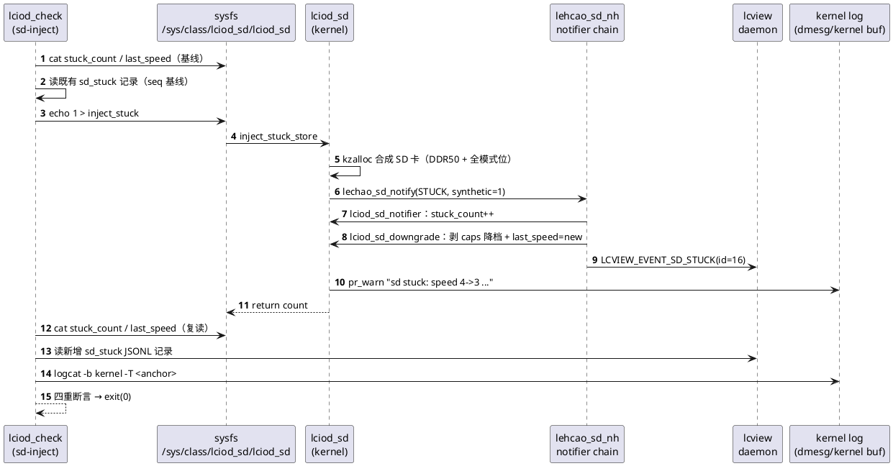
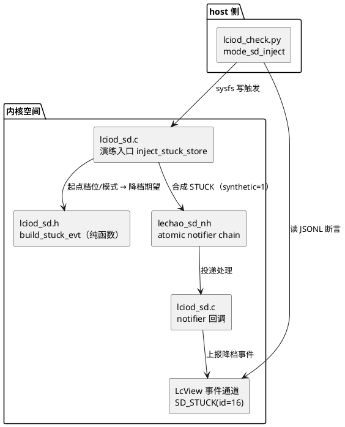
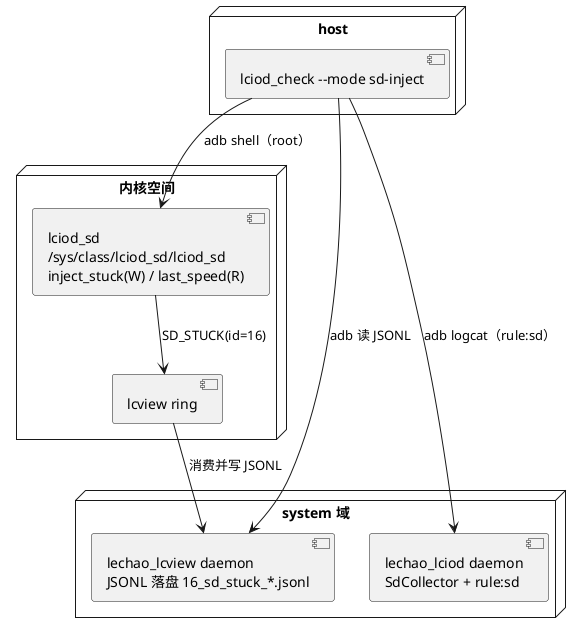

# SD 故障演练闭环

## 概述

SD 自愈演练接口与故障面断言闭环：以内核 `lciod_sd` 新增的 root-only 演练属性
`inject_stuck` 为入口，在**内存中合成**一次 STUCK 事件并走完整 notifier 处理链
（`stuck_count` 递增 → 剥 caps 降档 → `SD_STUCK`(id=16) 上报），host 侧
`lciod_check.py --mode sd-inject` 自驱注入并按四重判据断言故障面全链贯通。

- **职责**：为 SD 卡 STUCK 自愈链路提供**可重复、零硬件依赖**的演练与断言能力
- **上下游**：上游为内核 `lciod_sd` 模块（sysfs + `LCVIEW_EVENT_SD_STUCK`）；
  下游为 host 侧验收用例（`lciod-sd-inject`）与 lcview JSONL 落盘
- **对外接口**：sysfs `inject_stuck`（写触发）/ `last_speed`（只读）；
  CLI `lciod_check.sh --mode sd-inject`（退出码 0/1/2）

**设计理念：** 演练事件在内存合成、合成卡临时分配随调用释放——**不依赖真卡
异常、不触碰真实 mmc 卡与硬件操作**，使故障面断言可在任意健康板上重复执行；
断言口径以"事件驱动的增量 + 交叉核对"为准（计数递增 + 新增 JSONL 记录 +
`last_speed` 与事件字段一致 + 内核留痕），避免周期性日志造成的假绿。

**源码路径：**

- 内核模块：[`code/rpi5/kernel/new/vendor/lechao/LcIod/lciod_sd.c`](../../code/rpi5/kernel/new/vendor/lechao/LcIod/lciod_sd.c)
- 演练契约纯函数：[`code/rpi5/kernel/new/vendor/lechao/LcIod/lciod_sd.h`](../../code/rpi5/kernel/new/vendor/lechao/LcIod/lciod_sd.h)
- notifier 契约：[`code/rpi5/kernel/new/drivers/mmc/core/lechao_sd_notifier.h`](../../code/rpi5/kernel/new/drivers/mmc/core/lechao_sd_notifier.h)
- host 单测：[`code/rpi5/kernel/new/vendor/lechao/LcIod/tests/lciod_sd_host_test.c`](../../code/rpi5/kernel/new/vendor/lechao/LcIod/tests/lciod_sd_host_test.c)
- 板端验收：[`harness/skills/workspace-verify/cases/lciod_check.py`](../../harness/skills/workspace-verify/cases/lciod_check.py)

> **关联文档：** SD 健康监控主体设计见 [02.01-内核态增强-lciod-kernel.md](./02.01-内核态增强-lciod-kernel.md)
> 与 [02.03-Daemon增强-lciod-daemon.md](./02.03-Daemon增强-lciod-daemon.md)（SD_HEALTH/SD_STUCK
> 事件与 sysfs 采集）；落地实况见 [02.06-IO增强落地报告.md](./02.06-IO增强落地报告.md)。

## 用例视图

### 正常路径：合成 STUCK 端到端演练

host 侧 `lciod_check.sh --mode sd-inject` 注入前先读 `stuck_count`/`last_speed`
基线与既有 `sd_stuck` 记录，再写 `inject_stuck` 触发一次合成事件，随后轮询等待
计数与 JSONL 落盘并逐项断言。



### 异常路径：注入不可用或故障面缺失

任一环节缺失即判红（`exit 1`），交 loop/emit 定位——**不因无真卡异常而假绿**。

```plantuml
@startuml
start
:注入前读 stuck_count/last_speed 基线;
if (sysfs 不可读?) then (是)
  :判红（exit 1）;<<#pink>>
  stop
endif
:取设备时钟锚点;
if (写 inject_stuck 失败?) then (是)
  :判红（root-only 不可写）;<<#pink>>
  stop
endif
:轮询计数与 JSONL 落盘;
if (stuck_count 未增 或 无新增 sd_stuck?) then (是)
  :判红（注入未生效）;<<#pink>>
  stop
endif
if (事件 old<=new 或 last_speed 与 new 不符?) then (是)
  :判红（未反映降档）;<<#pink>>
  stop
endif
if (logcat -b kernel 与 dmesg 均无留痕?) then (是)
  :判红（内核留痕缺失）;<<#pink>>
  stop
endif
:判绿（exit 0）;<<#lightgreen>>
stop
@enduml
```

## 逻辑视图

### 模块分解



### 故障面断言矩阵

| 断言项 | 判据 | 判红条件 | 防假绿要点 |
|--------|------|---------|-----------|
| 计数递增 | `stuck_count` 注入后 > 注入前 | 未增 | 注入前先读基线，非绝对值 |
| 事件新增 | lcview JSONL 出现 `id==16` 且 `seq > 基线` | 无新增 | 用 seq 增量而非条数，防轮转误判 |
| 降档反映 | 事件 `old_speed > new_speed` 且 `last_speed == new_speed` | 未降档/不一致 | 交叉核对 sysfs 与事件字段 |
| 内核留痕 | `logcat -b kernel -T` 命中 `sd stuck`，或 dmesg 计数增量 | 均无 | 锚点取注入前设备时钟，防旧留痕 |

## 过程视图

### 演练流程与时序契约

1. **基线**：读 `stuck_count`、`last_speed`；读既有 `sd_stuck` 记录取最大 `seq`；
   记录 dmesg 中 `sd stuck` 出现次数。
2. **锚点**：未显式给 `--log-since` 时取设备时钟（`logcat -T` 只判锚点后缓冲）。
3. **注入**：`echo 1 > /sys/class/lciod_sd/lciod_sd/inject_stuck`，触发一次合成
   STUCK（幂等一次性——每次写入各触发一次，合成卡每次从同一起点重建）。
4. **等待**：轮询（最多 ~12s）至计数递增且 JSONL `seq` 递增；daemon 消费 ring
   落盘存在延迟，轮询吸收该抖动。
5. **断言**：按上方矩阵四重校验；任一项不满足判红。

### 关键不变量

| 不变量 | 保证机制 | 代码位置 |
|--------|---------|---------|
| 合成卡不污染真实卡指针 | 回调仅在 `!nd->synthetic` 时写 `sd_state.card` | [`lciod_sd.c:250`](../../code/rpi5/kernel/new/vendor/lechao/LcIod/lciod_sd.c#L250) |
| 演练不触碰真实 mmc 硬件 | 合成卡 `kzalloc` → 合成事件 → `kfree`，全内存 | [`lciod_sd.c:429`](../../code/rpi5/kernel/new/vendor/lechao/LcIod/lciod_sd.c#L429) |
| 演练与生产降档同源 | 起点/预期由 `lciod_sd_build_stuck_evt` 纯函数构造，回调复用同一降档纯函数 | [`lciod_sd.h:118`](../../code/rpi5/kernel/new/vendor/lechao/LcIod/lciod_sd.h#L118) |
| `last_speed` 仅降档时更新 | 仅 `lciod_sd_downgrade` 内 `WRITE_ONCE` | [`lciod_sd.c:184`](../../code/rpi5/kernel/new/vendor/lechao/LcIod/lciod_sd.c#L184) |

## 开发视图

### 文件职责矩阵

| 文件 | 职责 | 本批改动 |
|------|------|---------|
| `lechao_sd_notifier.h` | notifier 事件载荷契约 | 新增 `synthetic` 合成标记字段 |
| `lciod_sd.h` | 降档/SSR/演练纯函数（host 可测） | 新增演练起点常量与 `lciod_sd_build_stuck_evt` |
| `lciod_sd.c` | notifier 回调 + sysfs + 演练入口 | 新增 `last_speed` 只读、`inject_stuck` 触发、合成标记防污染 |
| `tests/lciod_sd_host_test.c` | host 纯逻辑单测 | 新增演练事件构造用例 |

### 构建集成

- 内核模块随 `CONFIG_VENDOR_LECHAO_SD`（built-in）编译入 vmlinux；
  演练属性随之注册，无需额外编译开关。
- host 单测经 `tests/Makefile` 的 `lciod_sd_host_test` 目标由 selfcheck 编译执行
  （无内核依赖，gcc host 编译）。
- 板端用例 `lciod-sd-inject` 登记于
  [`harness/config/verify-cases.yaml`](../../harness/config/verify-cases.yaml)，
  由 `lciod_check.sh --mode sd-inject` 承接。

## 部署视图

### 运行时拓扑



### 安全边界

- **仅内存模拟**：演练入口以 `kzalloc` 构造一张临时 `struct mmc_card`（起点 DDR50 +
  全模式位），构造合成 STUCK 事件后经 notifier 链走降档；事件处理完毕即 `kfree`。
  全过程**不读写真实 mmc 卡结构、不发起任何 mmc 主机命令**。
- **不污染真实卡指针**：合成事件置 `synthetic=1`，回调据此跳过 `sd_state.card`
  写入，避免 `kfree` 后 SSR 刷新线程读到悬空指针（[`lciod_sd.c:250`](../../code/rpi5/kernel/new/vendor/lechao/LcIod/lciod_sd.c#L250)）。
- **root-only 入口**：`inject_stuck` 以 `DEVICE_ATTR_WO`（0200）暴露，仅 owner（root）
  可写，非特权进程无法触发演练。
- **可重复、无持久副作用**：每次写入从同一起点重建合成卡，`last_speed` 恒收敛到
  同一降档结果；不写系统盘、不改真实卡参数，可任意健康板重复执行。

### 验证

- **host 单测**：`tests/lciod_sd_host_test.c` 覆盖演练事件构造契约（起点降档、
  最低档、未知档位、NULL 安全）。
- **板端用例**：`lciod-sd-inject` 四重断言端到端判绿/判红。

## 关键设计与实现

### 合成卡 + synthetic 标记 — 演练与真实解耦

演练入口在内存构造合成卡并置 `synthetic=1`；notifier 回调对合成事件执行
`stuck_count++` 与 `lciod_sd_downgrade`（降档发生在合成卡内存），但**不**把合成卡
写入 `sd_state.card`。由此既复用完整 notifier 处理路径（口径与生产一致），又
彻底隔离真实卡状态。

### 起点契约纯函数 — 演练口径与单测同源

`lciod_sd_build_stuck_evt`（[`lciod_sd.h:118`](../../code/rpi5/kernel/new/vendor/lechao/LcIod/lciod_sd.h#L118)）
以 `LCIOD_SD_DRILL_START_SPEED`/`_MODE`/`_ERR` 为起点，调用与回调同源的
`next_lower_speed`/`strip_modes_above` 计算降档期望（DDR50→SDR104，模式 0x1F→0x0F）。
kernel 侧用其初始化合成卡，host 单测直接断言期望值——两侧同源防漂移。

## 接口参考

### sysfs 属性（`/sys/class/lciod_sd/lciod_sd/`）

| 属性 | 权限 | 说明 |
|------|------|------|
| `inject_stuck` | 写（0200，root-only） | 写一次触发一次合成 STUCK 演练 |
| `last_speed` | 只读 | 最近一次降档后速度档位（`LCIOD_SD_SPEED_*`，0 起） |
| `stuck_count` | 只读 | 累计 STUCK 次数（演练/真实均计入） |

### lcview JSONL 记录（`16_sd_stuck_<YYYYMMDD>_pN.jsonl`）

目录 `/data/vendor/lechao_lcview/logs`；记录无 `name` 字段，判据取 `id`：

```json
{"ts":<ns>,"id":16,"level":2,"seq":<n>,"mono":<ns>,"f":[<old_speed>,<new_speed>,<err>,<stuck_count>]}
```

### CLI

```text
lciod_check.sh --mode sd-inject [--log-since <设备 epoch>]
```

退出码：`0` 通过 / `1` 判红 / `2` 设备不可达或校验失败（超时由 main 透传为 1）。

## 附录 A：端到端演练场景

```text
# 1. 触发一次合成 STUCK（root-only，写一次触发一次）
adb shell 'echo 1 > /sys/class/lciod_sd/lciod_sd/inject_stuck'

# 2. 读断言面：计数递增 + last_speed 降档
adb shell cat /sys/class/lciod_sd/lciod_sd/stuck_count
adb shell cat /sys/class/lciod_sd/lciod_sd/last_speed

# 3. 读 lcview JSONL（daemon 消费 ring 后落盘）
adb shell ls /data/vendor/lechao_lcview/logs
adb shell cat /data/vendor/lechao_lcview/logs/16_sd_stuck_<date>_p0.jsonl

# 4. 内核留痕
adb logcat -d -b kernel -T <注入前设备 epoch> | grep 'sd stuck'
```

一键验收：

```text
cases/lciod_check.sh --mode sd-inject
```

## 版本历史

| 版本 | 日期 | 变更内容 |
|------|------|---------|
| v1.0 | 2026-10-13 | 首版：SD 自愈演练接口（`inject_stuck`/`last_speed`）与 `lciod_check --mode sd-inject` 故障面断言闭环，含安全边界（内存模拟、root-only）与断言口径 |
