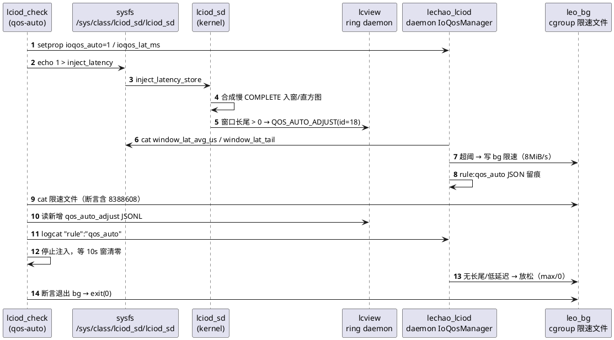
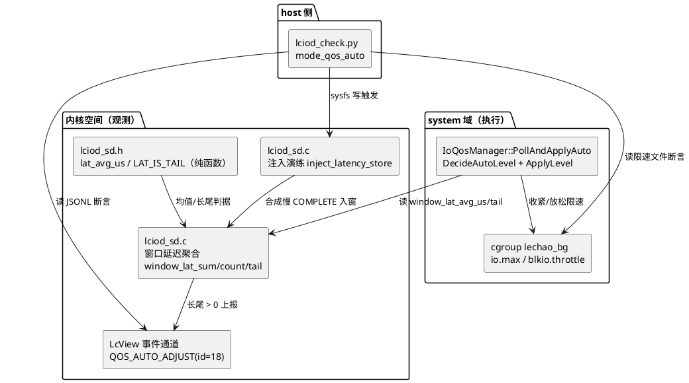
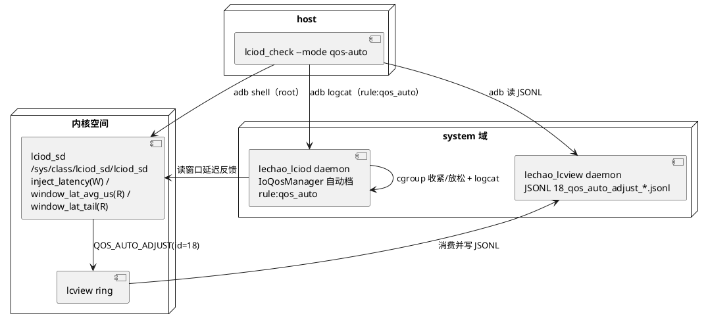

# IO QoS 延迟感知分级

## 概述

SD 卡写 QoS 的**延迟感知自动分级闭环**：内核 `lciod_sd` 在 10s 窗内聚合 SD 请求
延迟并只读导出窗口平均延迟与长尾计数（`window_lat_avg_us` / `window_lat_tail`）；
daemon `IoQosManager` 自动档读该反馈源，超阈时收紧 `lechao_bg` cgroup 的 bg 写
限速、延迟回落后放松，档位变化打 `rule:qos_auto` JSON 留痕；窗口出现长尾时内核
上报 `QOS_AUTO_ADJUST`(id=18) 事件落 lcview JSONL。root-only 演练属性
`inject_latency` 以**内存合成**慢 COMPLETE 抬升窗口延迟，使闭环可在任意健康板上
重复验证。

- **职责**：把"SD 窗口延迟"作为反馈源，驱动 SD 写限速档位的自动收紧/放松，
  并提供可重复、零硬件依赖的演练与断言能力
- **上下游**：上游为内核 `lciod_sd`（窗口延迟聚合 + `inject_latency` +
  `LCVIEW_EVENT_QOS_AUTO_ADJUST`）；下游为 daemon `IoQosManager` 自动档
  （cgroup 限速 + `rule:qos_auto`）与 host 侧验收用例（`qos-auto`）
- **对外接口**：sysfs `inject_latency`（写触发）/ `window_lat_avg_us`、
  `window_lat_tail`（只读）；sysprop `sys.lechao.lciod.ioqos_auto`、
  `sys.lechao.lciod.ioqos_lat_ms`；CLI `lciod_check.sh --mode qos-auto`

**设计理念：** 反馈源与执行体解耦——内核只做**观测**（窗口延迟导出与长尾事件），
daemon 只做**执行**（cgroup 档位应用与留痕）。演练在内存合成慢 COMPLETE 并复用
完整 notifier 处理链，**不依赖真卡异常、不触碰真实 mmc 卡、不写任何块设备**，
使"抬延迟 → 收紧 → 回落 → 放松"的闭环断言在任何健康板上可重复执行。

**源码路径：**

- 内核模块：[`code/rpi5/kernel/new/vendor/lechao/LcIod/lciod_sd.c`](../../code/rpi5/kernel/new/vendor/lechao/LcIod/lciod_sd.c)
- 窗口延迟/演练契约纯函数：[`code/rpi5/kernel/new/vendor/lechao/LcIod/lciod_sd.h`](../../code/rpi5/kernel/new/vendor/lechao/LcIod/lciod_sd.h)
- daemon 自动档：[`code/rpi5/aosp/new/vendor/lechao/services/lechao_lciod/daemon/io_qos.cpp`](../../code/rpi5/aosp/new/vendor/lechao/services/lechao_lciod/daemon/io_qos.cpp)
- 事件 schema：[`code/rpi5/aosp/new/vendor/lechao/services/lechao_lcview/config/lcview_events.json`](../../code/rpi5/aosp/new/vendor/lechao/services/lechao_lcview/config/lcview_events.json)
- 板端验收：[`harness/skills/workspace-verify/cases/lciod_check.py`](../../harness/skills/workspace-verify/cases/lciod_check.py)

> **关联文档：** SD 健康监控主体与 STUCK 演练见
> [02.01-内核态增强-lciod-kernel.md](./02.01-内核态增强-lciod-kernel.md)、
> [02.03-Daemon增强-lciod-daemon.md](./02.03-Daemon增强-lciod-daemon.md) 与
> [02.07-SD故障演练闭环.md](./02.07-SD故障演练闭环.md)；SD 写限速本体现状见
> [02.06-IO增强落地报告.md](./02.06-IO增强落地报告.md)。

## 用例视图

### 正常路径：延迟抬升 → 收紧 → 回落 → 放松

host 侧 `lciod_check.sh --mode qos-auto` 打开自动档并设置阈值后，反复写
`inject_latency` 合成慢 COMPLETE 抬升窗口延迟，daemon 自动档据此收紧 bg 限速；
停止注入待 10s 窗清零后窗口延迟回落，自动档放松。



### 异常路径：反馈源缺失或档位未按预期变化

任一环节缺失即判红（`exit 1`），交 loop/emit 定位——**不因闭环未真实生效而假绿**。

```plantuml
@startuml
start
:探测 cgroup 版本 + lechao_bg 组;
if (cgroup 组缺失?) then (是)
  :判红（无反馈面）;<<#pink>>
  stop
endif
:setprop ioqos_auto=1 + 阈值;
if (setprop 失败?) then (是)
  :判红（自动档不可开）;<<#pink>>
  stop
endif
:反复 inject_latency 注入抬延迟;
if (限速文件未进入 bg?) then (是)
  :判红（自动档未收紧）;<<#pink>>
  stop
endif
if (无新增 id=18 或 logcat 无 rule:qos_auto?) then (是)
  :判红（事件/留痕缺失）;<<#pink>>
  stop
endif
:停止注入等窗口回落;
if (限速文件仍为 bg?) then (是)
  :判红（未放松）;<<#pink>>
  stop
endif
:判绿（exit 0）;<<#lightgreen>>
stop
@enduml
```

## 逻辑视图

### 反馈源与执行体分解



### 档位策略

| 反馈态 | 自动档决策 | 限速效果 |
|--------|-----------|---------|
| 窗口长尾计数 > 0 | 收紧 `bg` | 写 8MiB/s（`wbps=8388608`） |
| 平均延迟 ≥ 阈值（`ioqos_lat_ms`，缺省 50ms） | 收紧 `bg` | 写 8MiB/s |
| 无长尾且平均延迟 < 阈值 | 放松 `off` | 写 max（v2）/ 0（v1，移除条目） |

> 阈值缺省 0 视为无效（仅长尾分支触发），防阈值缺省致恒收紧。

### 断言矩阵

| 断言项 | 判据 | 判红条件 | 防假绿要点 |
|--------|------|---------|-----------|
| 收紧生效 | 注入抬延迟后限速文件含 `8388608` | 未含 | 反复注入稀释真实流量，防单次注入被窗口均值稀释 |
| 事件新增 | lcview JSONL 出现 `id==18` 且 `seq > 基线` | 无新增 | 用 seq 增量而非条数，防轮转误判 |
| daemon 留痕 | logcat tag `lechao_lciod_event` 含 `"rule":"qos_auto"` | 无 | 锚点取注入前设备时钟，防旧留痕 |
| 回落放松 | 停止注入待窗口清零后限速文件退出 `bg` | 仍为 bg | 依赖 10s 窗真实清零，非人工复位 |

## 过程视图

### 闭环时序契约

1. **打开自动档**：`setprop ioqos_auto=1` 与 `ioqos_lat_ms=<阈值>`（thr_buf 非法
   回落缺省 50ms）。
2. **注入抬延迟**：反复 `echo 1 > .../inject_latency`（每次触发一次合成慢
   COMPLETE），抬升 `window_lat_sum_ns`/`window_lat_count`/`window_lat_tail`。
   重复注入防单次注入被 10s 窗内真实流量稀释。
3. **内核上报**：10s 窗到期若长尾计数 > 0，上报 `QOS_AUTO_ADJUST`(id=18)，携带
   本窗平均延迟/长尾计数/长尾阈值（单位微秒）。
4. **daemon 决策**：`PollAndApplyAuto` 每 1s 读反馈源 → `DecideAutoLevel` →
   `ApplyLevel`；档位变化时打 `rule:qos_auto` JSON 行（幂等：档位未变不重复应用）。
5. **断言**：轮询至 bg 收紧 + 新增 `id=18` + logcat 留痕后，停止注入待窗清零，
   轮询至限速文件退出 bg（放松）。

### 关键不变量

| 不变量 | 保证机制 | 代码位置 |
|--------|---------|---------|
| 反馈源窗口作用域 | 窗口到期在 `lciod_sd_window_work` 内清零 sum/count/tail | [`lciod_sd.c`](../../code/rpi5/kernel/new/vendor/lechao/LcIod/lciod_sd.c) |
| 演练不触碰真实 mmc 硬件 | `inject_latency` 合成 COMPLETE（无 card），仅内存入窗/直方图 | [`lciod_sd.c`](../../code/rpi5/kernel/new/vendor/lechao/LcIod/lciod_sd.c) |
| 均值除零防护 | `lciod_sd_lat_avg_us` count==0 返回 0 | [`lciod_sd.h`](../../code/rpi5/kernel/new/vendor/lechao/LcIod/lciod_sd.h) |
| 反馈源缺失不误收紧 | `ReadSdWindowLat` 不可读置 0（等价无长尾/低延迟） | [`io_qos.cpp`](../../code/rpi5/aosp/new/vendor/lechao/services/lechao_lciod/daemon/io_qos.cpp) |
| 应用失败不污染状态 | `ApplyLevel` 失败不更新 `lastAutoLevel_`，下轮重试 | [`io_qos.cpp`](../../code/rpi5/aosp/new/vendor/lechao/services/lechao_lciod/daemon/io_qos.cpp) |

## 开发视图

### 文件职责矩阵

| 文件 | 职责 | 本批改动 |
|------|------|---------|
| `lciod_sd.h` | 窗口延迟/演练纯函数（host 可测） | 新增长尾阈值、演练延迟常量、`lciod_sd_lat_avg_us`、长尾判据宏 |
| `lciod_sd.c` | 窗口延迟聚合 + sysfs + 演练入口 + 事件上报 | 新增窗口历时/计数/长尾累计、`window_lat_avg_us`/`window_lat_tail` 只读、`inject_latency` 触发、`QOS_AUTO_ADJUST` 上报 |
| `io_qos.h`/`io_qos.cpp` | daemon 自动档 | 新增 `ParseAutoFlag`/`DecideAutoLevel` 纯函数、`PollAndApplyAuto`、窗口延迟读取、`rule:qos_auto` 留痕 |
| `lcview_events.h`（内核/用户态镜像） | 事件 id 注册 | 新增 `LCVIEW_EVENT_QOS_AUTO_ADJUST` 18 |
| `lcview_events.json` | 事件 schema | 新增 id=18 `qos_auto_adjust`（字段 `avg_lat_us`/`tail_count`/`threshold_us`） |
| `tests/*` | 单测 | host 延迟均/长尾用例；daemon 自动档纯函数用例；lcview 事件数 16→17 |

### 构建集成

- 内核模块随 `CONFIG_VENDOR_LECHAO_SD`（built-in）编译入 vmlinux，演练/只读属性
  随之注册；`QOS_AUTO_ADJUST` 内核发射点登记于
  [`harness/lib/check_lcview_events.py`](../../harness/lib/check_lcview_events.py)
  的发射源清单（`lciod_sd.c`）。
- host 单测经 `tests/Makefile` 的 `lciod_sd_host_test` 目标由 selfcheck 编译执行。
- 板端用例 `qos-auto` 登记于
  [`harness/config/verify-cases.yaml`](../../harness/config/verify-cases.yaml)，
  由 `lciod_check.sh --mode qos-auto` 承接。

## 部署视图

### 运行时拓扑



### 安全边界

- **仅内存模拟**：`inject_latency` 构造一次 `LECHAO_SD_EVENT_COMPLETE` 合成事件
  （携带 500ms 历时 + 128KiB 块大小，无关联 `card`），经 notifier 链只做窗口
  累计与直方图入桶，**不读写真实 mmc 卡结构、不发起任何 mmc 主机命令、不写任何
  块设备**。
- **root-only 入口**：`inject_latency` 以 `DEVICE_ATTR_WO`（0200）暴露，仅 owner
  （root）可写；验收脚本前置 `adb root`。
- **限速面向 cgroup**：daemon 仅通过 cgroup v2 `io.max` / v1 `blkio.throttle.*`
  施加带宽上限，不直接操作块设备；off 档写 max/0 移除限速条目。
- **可重复、无持久副作用**：自动档由 sysprop 开关驱动，验收 `finally` 兜底清空
  `ioqos_auto`/`ioqos_lat_ms`，回落手动 `ioqos_level` 常规驱动；不写系统盘，可
  任意健康板重复执行。

### 验证

- **host 单测**：`lciod_sd_host_test.c` 覆盖平均延迟（含除零）与长尾判据；
  `IoQos_test.cpp` 覆盖 `ParseAutoFlag`/`DecideAutoLevel`（收紧/放松/阈值无效）。
- **板端用例**：`qos-auto` 四重断言端到端判绿/判红（收紧、事件、留痕、放松）。

## 接口参考

### sysfs 属性（`/sys/class/lciod_sd/lciod_sd/`）

| 属性 | 权限 | 说明 |
|------|------|------|
| `inject_latency` | 写（0200，root-only） | 写一次触发一次合成慢 COMPLETE 演练 |
| `window_lat_avg_us` | 只读 | 本窗口平均请求延迟（微秒，窗口到期清零） |
| `window_lat_tail` | 只读 | 本窗口长尾请求数（历时 ≥ 50ms，窗口到期清零） |

### sysprop（daemon 自动档）

| sysprop | 取值 | 说明 |
|---------|------|------|
| `sys.lechao.lciod.ioqos_auto` | `1`/`on`/`true` 开；`0`/`off`/空 关 | 自动档开关（开启时覆盖手动 `ioqos_level`） |
| `sys.lechao.lciod.ioqos_lat_ms` | 十进制毫秒，缺省 50 | 平均延迟阈值 |

### lcview JSONL 记录（`18_qos_auto_adjust_<YYYYMMDD>_pN.jsonl`）

目录 `/data/vendor/lechao_lcview/logs`；记录无 `name` 字段，判据取 `id`：

```json
{"ts":<ns>,"id":18,"level":2,"seq":<n>,"mono":<ns>,"f":[<avg_lat_us>,<tail_count>,<threshold_us>]}
```

### CLI

```text
lciod_check.sh --mode qos-auto [--log-since <设备 epoch>] \
    [--qos-auto-lat-ms <阈值ms>] [--qos-auto-rounds N] \
    [--qos-auto-relax-rounds N]
```

退出码：`0` 通过 / `1` 判红 / `2` 设备不可达或校验失败（超时由 main 透传为 1）。

## 附录 A：端到端演练场景

```text
# 1. 打开自动档 + 阈值
adb shell setprop sys.lechao.lciod.ioqos_auto 1
adb shell setprop sys.lechao.lciod.ioqos_lat_ms 50

# 2. 注入抬延迟（root-only，写一次触发一次）
adb shell 'echo 1 > /sys/class/lciod_sd/lciod_sd/inject_latency'

# 3. 读反馈源与限速文件
adb shell cat /sys/class/lciod_sd/lciod_sd/window_lat_avg_us
adb shell cat /sys/class/lciod_sd/lciod_sd/window_lat_tail
adb shell cat /sys/fs/cgroup/lechao_bg/io.max   # 收紧含 8388608

# 4. 读 lcview JSONL 与 daemon 留痕
adb shell ls /data/vendor/lechao_lcview/logs
adb shell cat /data/vendor/lechao_lcview/logs/18_qos_auto_adjust_<date>_p0.jsonl
adb logcat -d -s lechao_lciod_event | grep 'qos_auto'

# 5. 停止注入，等 10s 窗清零后限速文件应退出 bg

# 6. 收尾（还原自动档）
adb shell setprop sys.lechao.lciod.ioqos_auto ""
adb shell setprop sys.lechao.lciod.ioqos_lat_ms ""
```

一键验收：

```text
cases/lciod_check.sh --mode qos-auto
```

## 版本历史

| 版本 | 日期 | 变更内容 |
|------|------|---------|
| v1.0 | 2026-10-13 | 首版：SD 窗口延迟反馈源（`window_lat_avg_us`/`window_lat_tail`）+ `inject_latency` 演练 + daemon `IoQosManager` 自动档（`ioqos_auto`/`ioqos_lat_ms` + `rule:qos_auto`）+ `QOS_AUTO_ADJUST`(id=18) 事件与 `lciod_check --mode qos-auto` 闭环断言 |
