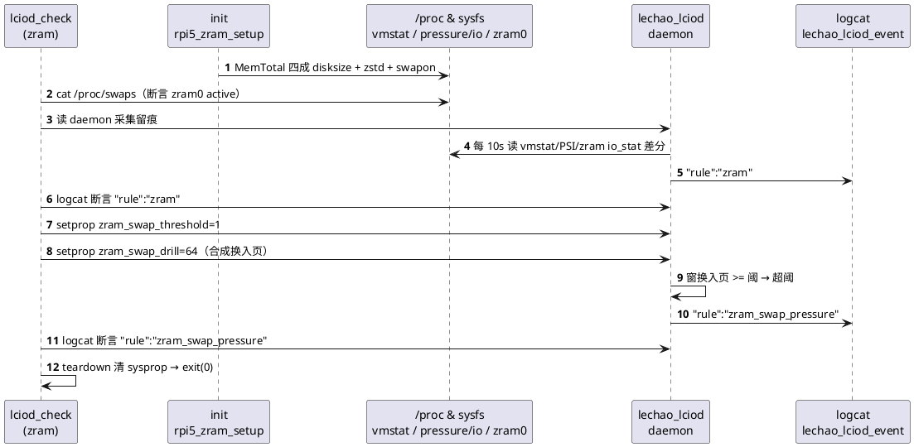
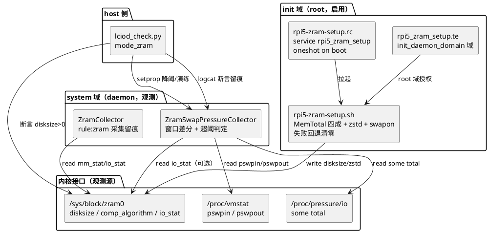
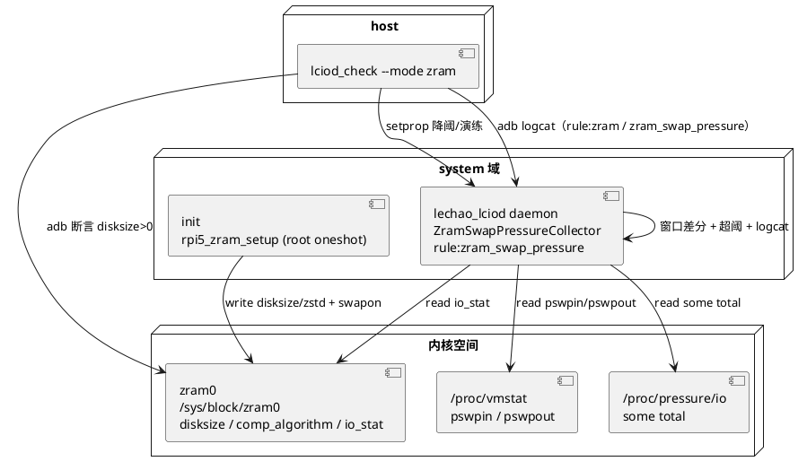

# zram 换入压力观测

## 概述

面向 IO 退化的**换入（swap-in）压力观测闭环**：开机由 init（root）按 MemTotal
四成自适应启用 `zram0`（`zstd` 压缩 + `swapon`）；用户态 daemon 每 10s 聚合
`/proc/vmstat` 换入/换出页数、`/proc/pressure/io`（PSI io）some total 与
`zram0 io_stat` 读写字节的**单调差分**，窗口换入页数超阈即合成
`rule:zram_swap_pressure` JSON 留痕并上报 `ZRAM_SWAP_PRESSURE`(id=19) 事件；
host 侧 `lciod_check.sh --mode zram` 三段断言闭环。

- **职责**：把"zram 可用 + 换入压力"作为可观测的 IO 退化信号，提供
  **零真实内存压力**（OOM-safe）的可重复演练与断言能力
- **上下游**：上游为内核 zram/PSI/vmstat 子系统（`/sys/block/zram0`、
  `/proc/pressure/io`、`/proc/vmstat`）与 init 启用脚本；下游为 daemon
  `ZramSwapPressureCollector` 与 host 侧验收用例 `zram`
- **对外接口**：sysfs `/sys/block/zram0/{disksize,comp_algorithm,io_stat}`；
  sysprop `sys.lechao.lciod.zram_swap_threshold`、`sys.lechao.lciod.zram_swap_drill`；
  CLI `lciod_check.sh --mode zram`

**设计理念：** **启用（root）与观测（daemon）分层，演练确定性化**。zram 配置与
`swapon` 需要 `CAP_SYS_ADMIN`，而 daemon 以 `user system` 运行且无该能力——故
启用必须由 init（root）oneshot 完成，daemon 只做**只读**采集与阈值判定。演练不
制造真实内存压力（防 OOM），而以 sysprop 合成"换入页数"（`zram_swap_drill`）
配合降阈注入，使"超阈触发"可在任意健康板上确定性复现。

**源码路径：**

- init 启用脚本：[`code/rpi5/aosp/new/device/brcm/rpi5/scripts/rpi5-zram-setup.sh`](../../code/rpi5/aosp/new/device/brcm/rpi5/scripts/rpi5-zram-setup.sh)
- init rc：[`code/rpi5/aosp/new/device/brcm/rpi5/scripts/rpi5-zram-setup.rc`](../../code/rpi5/aosp/new/device/brcm/rpi5/scripts/rpi5-zram-setup.rc)
- sepolicy 域：[`code/rpi5/aosp/new/device/brcm/rpi5/sepolicy/rpi5_zram_setup.te`](../../code/rpi5/aosp/new/device/brcm/rpi5/sepolicy/rpi5_zram_setup.te)
- daemon 采集与上报：[`code/rpi5/aosp/new/vendor/lechao/services/lechao_lciod/daemon/block_collector.cpp`](../../code/rpi5/aosp/new/vendor/lechao/services/lechao_lciod/daemon/block_collector.cpp)
- 事件 schema：[`code/rpi5/aosp/new/vendor/lechao/services/lechao_lcview/config/lcview_events.json`](../../code/rpi5/aosp/new/vendor/lechao/services/lechao_lcview/config/lcview_events.json)
- 板端验收：[`harness/skills/workspace-verify/cases/lciod_check.py`](../../harness/skills/workspace-verify/cases/lciod_check.py)

> **关联文档：** daemon 采集框架与 SD 健康观测见
> [02.03-Daemon增强-lciod-daemon.md](./02.03-Daemon增强-lciod-daemon.md)；
> QoS 延迟感知分级（同为 daemon 合成事件）见
> [02.08-IO-QoS延迟感知分级.md](./02.08-IO-QoS延迟感知分级.md)；落地现状见
> [02.06-IO增强落地报告.md](./02.06-IO增强落地报告.md)。

## 用例视图

### 正常路径：启用 → 采集留痕 → 降阈+合成换入触发

host 侧 `lciod_check.sh --mode zram` 先断言 swap 生效与采集留痕，再降阈并注入
合成换入页以确定性触发换入压力上报。



### 异常路径：启用缺失或事件未触发

任一环节缺失即判红（`exit 1`），交 loop/emit 定位——**不因闭环未真实生效而假绿**。

```plantuml
@startuml
start
:读 /proc/swaps + zram0 disksize;
if (swap 未生效 / 不可读?) then (是)
  :判红（init 启用未生效）;<<#pink>>
  stop
endif
:轮询 logcat "rule":"zram";
if (无采集留痕?) then (是)
  :判红（采集未留痕）;<<#pink>>
  stop
endif
:降阈 + 注入合成换入页;
repeat
  :轮询 logcat "rule":"zram_swap_pressure";
repeat while (未命中且未超轮数?)
if (仍无换入压力留痕?) then (是)
  :判红（事件未触发）;<<#pink>>
  stop
endif
:判绿（exit 0）;<<#lightgreen>>
stop
@enduml
```

## 逻辑视图

### 启用与观测分层



### 超阈判定

| 反馈态 | 判定 | 上报 |
|--------|------|------|
| 窗口换入页数 > 0 且 ≥ 阈值（缺省 256） | 超阈 | `rule:zram_swap_pressure`（超阈段首窗一条） |
| 阈值 = 0（演练降阈） | 任何**非零**换入即超阈 | 同上 |
| 窗口换入页数 = 0 或 < 阈值 | 未超阈 | 不上报，边沿状态复位 |

> 阈值 0 仍要求换入页数 > 0（`ShouldReportZramSwapPressure`），防"零活动"被
> 误判为超阈假绿。

## 过程视图

### 闭环时序契约

1. **开机启用**：init `on boot` 拉起 `rpi5_zram_setup`（root oneshot），脚本按
   `MemTotal` 四成写 `disksize`、置 `comp_algorithm=zstd`、`mkswap`+`swapon`；
   任一步失败即 `swapoff`+清零回退，**恒 exit 0，绝不阻断 boot**。
2. **周期采集**：daemon `BlockCollectorRunLoop` 每约 10s 采样一次：
   `/proc/vmstat`（`pswpin`/`pswpout`）、`/proc/pressure/io`（`some` 行 `total`）、
   `/sys/block/zram0/io_stat`（可选）；首窗只建基线（`primed=false`），此后按
   单调差分得窗口增量。
3. **超阈判定与上报**：`effective = 窗口换入页数 + 演练合成页`；
   `effective ≥ 阈值 && effective > 0` 且上一窗未超阈（**边沿触发**）时，输出
   `rule:zram_swap_pressure` JSON 行（含 `swapin_pages`/`swapout_pages`/
   `zram_read_bytes`/`zram_write_bytes`/`psi_io_total_us`/`drill_pages`/
   `effective_pages`/`threshold_pages`）。
4. **演练**：验收 `setprop zram_swap_threshold=1` + `zram_swap_drill=<页>`；
   daemon 对 `zram_swap_drill` 取"值变化一次性计入"，与实测换入相加后判定，
   **不制造真实内存压力**。
5. **断言**：三段断言（启用、留痕、触发）全部通过后 `finally` 清空两个
   sysprop，回 daemon 缺省阈值。

### 关键不变量

| 不变量 | 保证机制 | 代码位置 |
|--------|---------|---------|
| 启用需 root、观测不需 | init oneshot 配置 + swapon；daemon 仅只读采集 | [`rpi5-zram-setup.rc`](../../code/rpi5/aosp/new/device/brcm/rpi5/scripts/rpi5-zram-setup.rc) |
| 失败不阻断启动 | 脚本 `fail()` 回退清零且恒 `exit 0` | [`rpi5-zram-setup.sh`](../../code/rpi5/aosp/new/device/brcm/rpi5/scripts/rpi5-zram-setup.sh) |
| 幂等不破坏在用 swap | 已启用（disksize>0 且在 swaps）直接跳过 | [`rpi5-zram-setup.sh`](../../code/rpi5/aosp/new/device/brcm/rpi5/scripts/rpi5-zram-setup.sh) |
| 窗口差分不下溢 | counter 回退时差分取 curr（reset 语义） | [`block_collector.cpp`](../../code/rpi5/aosp/new/vendor/lechao/services/lechao_lciod/daemon/block_collector.cpp) |
| 输入防御 | PSI/vmstat 解析整段十进制校验，非法判 false 不吞错 | [`block_collector.cpp`](../../code/rpi5/aosp/new/vendor/lechao/services/lechao_lciod/daemon/block_collector.cpp) |
| 采集失败不致命 | 采样失败限频 ALOGE 跳过本轮，线程不退出 | [`block_collector.cpp`](../../code/rpi5/aosp/new/vendor/lechao/services/lechao_lciod/daemon/block_collector.cpp) |
| 演练无 OOM 风险 | 合成页数仅计数，不触发真实内存分配/压测 | [`service.cpp`](../../code/rpi5/aosp/new/vendor/lechao/services/lechao_lciod/daemon/service.cpp) |

## 开发视图

### 文件职责矩阵

| 文件 | 职责 | 本批改动 |
|------|------|---------|
| `code/rpi5/aosp/new/device/brcm/rpi5/scripts/rpi5-zram-setup.sh` | 开机启用 zram0（root） | 新增：MemTotal 四成 disksize + zstd + swapon + 回退 |
| `scripts/rpi5-zram-setup.rc` | init service 定义 | 新增：`service rpi5_zram_setup`（oneshot，root，`on boot`） |
| `scripts/Android.bp` | 构建集成 | 新增 `sh_binary rpi5_zram_setup` + `prebuilt_etc rpi5_zram_setup_rc` |
| `sepolicy/rpi5_zram_setup.te` | 域与授权 | 新增：`init_daemon_domain` 域 + sysfs/block/proc 授权 |
| `code/rpi5/aosp/modified/device/brcm/rpi5/sepolicy/file_contexts.diff` | 文件标签 | 新增 `/system/bin/rpi5_zram_setup` 标签 |
| `device.mk.diff` | 产品打包 | 新增 `PRODUCT_PACKAGES`（脚本 + rc） |
| `block_collector.h`/`.cpp` | 采集纯函数与采集器 | 新增 `ParsePsiIoSome`/`ParseVmstatKey`/`ShouldReportZramSwapPressure`/`ZramSwapPressureCollector` |
| `service.cpp` | 主循环接线与上报 | 新增 `EmitZramSwapPressureJson` + 边沿触发 + sysprop 降阈/演练 |
| `lcview_events.h`（内核/用户态镜像） | 事件 id 注册 | 新增 `LCVIEW_EVENT_ZRAM_SWAP_PRESSURE` 19 |
| `lcview_events.json` | 事件 schema | 新增 id=19 `zram_swap_pressure` 字段定义 |
| `lechao_lciod.te` | daemon 只读授权 | 新增 `proc_pressure_io`/`proc_vmstat`/`sysfs_zram` 读 allow |
| `harness/skills/workspace-verify/cases/lciod_check.py` + `tests/*` | 板端用例与单测 | 新增 `--mode zram` 三段断言 + 破坏场景红灯单测 |
| `harness/config/verify-cases.yaml` | 用例与模块登记 | 新增 `zram` 用例 + 模块 targets/push |

### 构建集成

- init 脚本与 rc 经 `device/brcm/rpi5/scripts/Android.bp` 分别产出
  `/system/bin/rpi5_zram_setup` 与 `/system/etc/init/rpi5-zram-setup.rc`，由
  `device.mk` 的 `PRODUCT_PACKAGES` 打包入 system 分区。
- daemon 改动随 `lechao_lciod` cc_binary 编译；`ZRAM_SWAP_PRESSURE` 为 daemon
  合成事件，内核无发射点，登记于
  [`harness/lib/check_lcview_events.py`](../../harness/lib/check_lcview_events.py)
  的 `DISABLED_EVENTS`。
- 板端用例 `zram` 登记于
  [`harness/config/verify-cases.yaml`](../../harness/config/verify-cases.yaml)，
  由 `lciod_check.sh --mode zram` 承接。

## 部署视图

### 运行时拓扑



### 安全边界

- **仅内存压缩设备**：zram0 为纯内存压缩块设备，无物理介质；启用/采集均不触碰
  任何 SD 卡 / USB 盘 / 物理块设备，**无破坏性写**。
- **启用最小权限**：脚本以 root oneshot 运行，域 `rpi5_zram_setup` 仅授予 zram
  配置、`swapon`、`/proc/meminfo` 读取与 `/dev/kmsg` 留痕所需 allow，遵循最小
  权限。
- **观测只读**：daemon 对 PSI/vmstat/zram io_stat 仅 `read`；缺授权时采样失败
  仅跳过本轮（限频 ALOG），不触发进程退出。
- **演练无 OOM**：演练页数仅在用户态计数合成，不分配内存、不写 swap，可在任意
  健康板重复执行。
- **可重复、无持久副作用**：验收 `finally` 兜底清空 `zram_swap_threshold`/
  `zram_swap_drill`；zram 启用状态由 init 幂等维持。

### 验证

- **host 单测**：`block_collector_test.cpp` 覆盖 `ParsePsiIoSome`/`ParseVmstatKey`/
  `ShouldReportZramSwapPressure`（含 full 行拒绝、缺字段、阈值 0 边界）。
- **板端用例**：`zram` 三段断言端到端判绿/判红（启用、留痕、触发）。

## 接口参考

### sysfs 属性（`/sys/block/zram0/`）

| 属性 | 权限 | 说明 |
|------|------|------|
| `disksize` | 读写（root） | 换入设备容量（字节，0 = 未启用） |
| `comp_algorithm` | 读写（root） | 压缩算法（置 `zstd`） |
| `io_stat` | 只读 | 读/写字节与请求数（换入读 / 换出写） |

### 系统文件

| 路径 | 说明 |
|------|------|
| `/proc/swaps` | 当前生效 swap 表（含 `/dev/block/zram0` 即已启用） |
| `/proc/vmstat` | `pswpin`（换入页数）/ `pswpout`（换出页数） |
| `/proc/pressure/io` | PSI io `some` 行 `total`（累计阻塞微秒） |

### sysprop（daemon 换入压力）

| sysprop | 取值 | 说明 |
|---------|------|------|
| `sys.lechao.lciod.zram_swap_threshold` | 十进制页数，缺省 256 | 窗口换入页数超阈阈值（0 = 任何非零换入即触发） |
| `sys.lechao.lciod.zram_swap_drill` | 十进制页数 | 合成换入页数（值变化一次性计入，OOM-safe 演练） |

### lcview / logcat 记录

daemon 通过 tag `lechao_lciod_event`（`EVENT_ALOG`）输出 JSON 行：

```json
{"rule":"zram","mem_used_total":<B>,"mem_used_max":<B>,"compr_ratio":<f>,"failed_reads":<n>,"failed_writes":<n>,"read_bytes":<B>,"write_bytes":<B>}
{"rule":"zram_swap_pressure","swapin_pages":<n>,"swapout_pages":<n>,"zram_read_bytes":<B>,"zram_write_bytes":<B>,"psi_io_total_us":<us>,"drill_pages":<n>,"effective_pages":<n>,"threshold_pages":<n>}
```

事件 id=19（`zram_swap_pressure`）登记于 schema；内核无发射点，按停发语义在
`DISABLED_EVENTS` 豁免。

### CLI

```text
lciod_check.sh --mode zram [--log-since <设备 epoch>] \
    [--zram-drill-pages N] [--zram-threshold-pages N] [--zram-rounds N]
```

退出码：`0` 通过 / `1` 判红 / `2` 设备不可达（超时由 main 透传为 1）。

## 附录 A：端到端演练场景

```text
# 1. 确认 zram 启用（init 已 swapon）
adb shell cat /proc/swaps
adb shell cat /sys/block/zram0/disksize

# 2. 确认 daemon 采集留痕
adb logcat -d -s lechao_lciod_event | grep 'zram'

# 3. 降阈 + 合成换入页触发换入压力上报（OOM-safe）
adb shell setprop sys.lechao.lciod.zram_swap_threshold 1
adb shell setprop sys.lechao.lciod.zram_swap_drill 64
adb logcat -d -s lechao_lciod_event | grep 'zram_swap_pressure'

# 4. 收尾（回 daemon 缺省阈值）
adb shell setprop sys.lechao.lciod.zram_swap_threshold ""
adb shell setprop sys.lechao.lciod.zram_swap_drill ""
```

一键验收：

```text
cases/lciod_check.sh --mode zram
```

## 版本历史

| 版本 | 日期 | 变更内容 |
|------|------|---------|
| v1.0 | 2026-10-13 | 首版：init 启用 zram0（MemTotal 四成 + zstd + swapon，失败回退）+ daemon 换入压力窗聚合（vmstat/PSI/zram io_stat 差分）+ `ZRAM_SWAP_PRESSURE`(id=19) 事件 + `lciod_check --mode zram` 三段断言闭环 |
