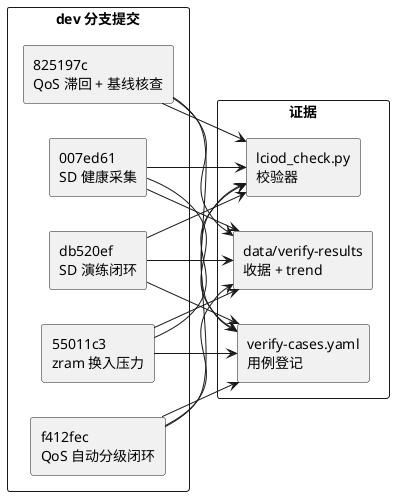
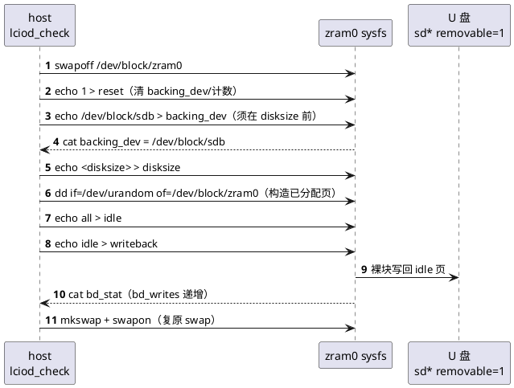

# 新轮次落地报告（QoS / SD / zram writeback）

## 概述

本文档是新轮次 IO 增强的**收官落地报告**：对已落地的三条线——**QoS 延迟感知
自动分级**（02.08）、**SD 故障演练闭环**（02.07）、**zram 换入压力观测**
（02.09）——逐条重建 git 证据链（commit ↔ 收据 ↔ 验收 case），并给出本批
**zram writeback 预研**的机制核查结论与落地口径。

- **职责**：把上一轮"已实现"的声明收敛为**可追溯的 git 证据**（避免"已处理"
  式空口径），并沉淀 zram 写回预研的环境基线与机制约束。
- **上下游**：上游为 02.07/02.08/02.09 三个子文档与 `data/verify-results/`
  收据；下游为后续 zram 写回常态化观测与基线发布。
- **对外接口**：git commit（dev 分支）、`data/verify-results/*.md` 收据、
  `lciod_check.sh --mode {zram,sd-inject,qos-auto,zram-writeback}`。

> **关联文档**：SD 演练见 [02.07-SD故障演练闭环.md](./02.07-SD故障演练闭环.md)；
> QoS 延迟分级见 [02.08-IO-QoS延迟感知分级.md](./02.08-IO-QoS延迟感知分级.md)；
> zram 换入压力见 [02.09-zram换入压力观测.md](./02.09-zram换入压力观测.md)；
> 历史收官见 [02.06-IO增强落地报告.md](./02.06-IO增强落地报告.md)。

## 一、git 证据重建

上一轮三条线均为 dev 分支顺序落地，每条线以"新增(lciod): …"提交、随提交携带
`data/verify-results/` 收据（build/board 证据）与 `trend.md` 打点行。重建如下。

| 线 | 子能力 | commit | 收据 | 板端 case |
|----|--------|--------|------|-----------|
| QoS 延迟分级 | 延迟反馈源 + 自动档收紧/放松 | `f412fec` 新增(lciod): QoS 延迟感知自动分级闭环 | `20261013-160022-7561f427ba44.md` | `qos-auto` |
| QoS 延迟分级 | 自动档滞回 + zram 环境基线核查 | `825197c` 新增(lciod): QoS 自动档滞回与 zram 环境基线核查 | `20261013-174613-f6d4ab0dbde0.md` | `qos-auto` |
| SD 演练 | SD 用户态健康采集（sysfs SSR + ALOG sd JSON） | `007ed61` 新增(lciod): SD 用户态健康采集 | `20261012-100713-da7ebadae4b2.md` | `sd` |
| SD 演练 | 自愈演练接口（inject_stuck/last_speed）+ 故障面断言 | `db520ef` 新增(lciod): SD 自愈演练接口与故障面断言闭环 | `20261013-145232-38a8dfb015c6.md` | `sd-inject` |
| zram 观测 | zram0 启用（init root）+ 换入压力窗聚合 | `55011c3` 新增(lciod): zram 启用与换入压力观测闭环 | `20261013-203853-4fae5087fbd4.md` | `zram` |

**证据链口径**：每条 commit 均携带 `code/` 源码改动 + `harness/config/verify-cases.yaml`
用例登记 + `harness/skills/workspace-verify/cases/lciod_check.py` 校验器 + 对应
`data/verify-results/*.md`（`board=pass`/`skip`）与 `trend.md` 打点。收据
`commit_scope` 段可反查该批 `add/mod/del` 文件清单，避免"声明改了但没落盘"。



## 二、zram writeback 预研

### 2.1 环境基线（ENV-BASE-001）

方案设计前实测目标设备（RPi5 / 内核 `6.6.116-v8`）环境基线，作为本预研的
锚点（均为 git 可见的探测结论，非推测）：

| 探测项 | 实测值 | 含义 |
|--------|--------|------|
| `/sys/block/zram0/backing_dev` | `none` | 未绑定写回后备 |
| `/sys/block/zram0/bd_stat` | `0 0 0` | 写回统计（bd_count/bd_reads/bd_writes，单位 4KiB 页） |
| `/sys/block/zram0/{idle,writeback,writeback_limit}` | 存在 | 内核 `CONFIG_ZRAM_WRITEBACK=y` |
| `/sys/block/sd*` | `sda removable=0`、`sdb removable=1` | sda 固定盘、sdb 可移除 U 盘 |
| `/sys/block/mmcblk0` | 存在 | 系统盘（SD/eMMC），**严禁作后备** |
| `CONFIG_ZRAM_WRITEBACK` | `y`（`bcm2712_defconfig`） | 写回能力编译期开启 |

### 2.2 机制约束（内核 `zram_drv.c` 实测核对）

1. **backing_dev 须在 disksize 之前绑定**：`backing_dev_store` 在 `init_done(zram)`
   为真时返回 `-EBUSY`（"Can't setup backing device for initialized device"）。
   因此绑定顺序必须是 `reset → backing_dev → disksize → mkswap → swapon`。
2. **后备须为块设备**：`backing_dev_store` 用 `filp_open_block` 打开后校验
   `S_ISBLK`，以**裸块**（bitmap + bio，非文件系统 bmap）方式写回；后备设备
   上不得同时 `mkswap`/`swapon`（swap 头与写回块重叠会互相破坏）。
3. **触发写回**：`echo all > idle`（标记全部已分配非 SAME 页为 idle）→
   `echo idle > writeback`（写回 idle 页），`bd_stat` 第 3 字段（bd_writes）
   单调递增。零页（`ZRAM_SAME`）不参与写回，故演练须写**随机页**构造已分配页。
4. **reset 清绑定**：`reset` 经 `zram_reset_device → reset_bdev` 释放 backing_dev
   绑定并清零统计，故回退路径 `swapoff + reset` 即可清除绑定。



### 2.3 落地形态

| 文件 | 职责 | 本批改动 |
|------|------|---------|
| `device/brcm/rpi5/scripts/rpi5-zram-setup.sh` | 开机启用 zram0（root） | 扩展：枚举 `sd* removable=1` U 盘作 `backing_dev`（disksize 前绑定）+ 标记 idle/触发 writeback；回退 `swapoff + reset` 清绑定；严禁 mmcblk |
| `daemon/block_collector.h`/`.cpp` | zram 采集纯函数与采集器 | 新增 `ParseZramBdStat` + `ZramCollector::Sample.{bdCount,bdReads,bdWrites}`（bd_stat 可选增强源，缺失缺省 0 不判失败） |
| `daemon/service.cpp` | 主循环上报 | `EmitZramJson` 追加 `bd_count`/`bd_reads`/`bd_writes` 字段 |
| `tests/block_collector_test.cpp` | 单测 | 新增 `ParseZramBdStat` 三字段/裁剪补 0/空行判 false |
| `harness/skills/workspace-verify/cases/lciod_check.py` | 板端校验器 | 新增 `--mode zram-writeback`（U 盘在位断言 binding + bd_stat 递增，不在位 SKIP；自驱配置与复原） |
| `harness/config/verify-cases.yaml` | 用例登记 | 新增 `zram-writeback` 用例（timeout 300） |

### 2.4 预研结论

- **可行**：目标设备内核 `CONFIG_ZRAM_WRITEBACK=y`，`backing_dev` 绑定 +
  `idle`/`writeback` 触发 + `bd_stat` 递增机制**端到端实测通过**（`bd_stat`
  由 `0 0 0` → `16 0 16`，mkswap+swapon 复原成功）。
- **安全边界**：写回后备**仅取 `removable=1` 的 `sd*` U 盘**（可移除测试介质），
  严禁系统盘 `mmcblk`；写回为裸块写 U 盘，不触碰系统盘/SD 卡。
- **待办（下一轮）**：将写回阈值策略（`writeback_limit`/`writeback_limit_enable`）
  纳入 daemon 自动决策；把写回量（`bd_writes` 差分）接入 IO 退化判定，形成
  "换出 → 写回 → 观测 → 决策"闭环。

## 三、验证与安全

### 3.1 板端用例

- `zram-writeback`：U 盘在位时断言 `backing_dev` 绑定 + `bd_stat` 写回页数严格
  递增；不在位打印 `SKIP:`（验收层转 skip 不判红）。防假绿：U 盘在位但绑定
  未生效 / `bd_stat` 不可读 / 写回未递增均判红。
- 复用既有 `qos-auto`/`sd-inject`/`zram` 三 case 回归（见 02.07/02.08/02.09）。

### 3.2 副作用与恢复

| 动作 | 副作用 | 恢复 |
|------|--------|------|
| `zram-writeback` 自驱配置 zram0 | 短暂 `swapoff`，swap 内容丢弃（可恢复态） | 收尾 `mkswap + swapon` 复原；`backing_dev` 保持绑定 |
| backing_dev 裸块写 U 盘 | 覆写 U 盘裸块 | U 盘为可移除测试介质，无有效数据（常备授权） |
| init 脚本开机写回 | 仅 zram0 内存设备 + U 盘裸块 | `fail()` 回退 `swapoff + reset` 清绑定 |

### 3.3 关键不变量

| 不变量 | 保证机制 | 代码位置 |
|--------|---------|---------|
| 后备须在 disksize 前绑定 | 脚本顺序 `reset → backing_dev → disksize`；校验器回归锚点断言绑定早于 disksize | [`rpi5-zram-setup.sh`](../../code/rpi5/aosp/new/device/brcm/rpi5/scripts/rpi5-zram-setup.sh)、[`lciod_check.py`](../../harness/skills/workspace-verify/cases/lciod_check.py) |
| 严禁选系统盘 | 枚举仅匹配 `sd*` 且 `removable==1`，`mmcblk` 前缀天然排除 | [`rpi5-zram-setup.sh`](../../code/rpi5/aosp/new/device/brcm/rpi5/scripts/rpi5-zram-setup.sh) |
| 回退清绑定 | `reset` 经 `reset_bdev` 释放 `backing_dev` | [`rpi5-zram-setup.sh`](../../code/rpi5/aosp/new/device/brcm/rpi5/scripts/rpi5-zram-setup.sh) |
| 采集失败不致命 | `bd_stat` 为可选增强源，缺失/解析失败仅缺省 0 + 限频 ALOGE | [`block_collector.cpp`](../../code/rpi5/aosp/new/vendor/lechao/services/lechao_lciod/daemon/block_collector.cpp) |
| 写回未生效不假绿 | 校验器断言 `bd_stat` 写回页数严格递增，未增判红 | [`lciod_check.py`](../../harness/skills/workspace-verify/cases/lciod_check.py) |

## 附录 A：writeback 手工核查

```text
# 1. 环境基线
adb shell cat /sys/block/zram0/backing_dev     # none
adb shell cat /sys/block/zram0/bd_stat         # 0 0 0
adb shell 'for d in /sys/block/sd*; do echo "$d=$(cat $d/removable)"; done'

# 2. 绑定与触发（示例；zram0 已 swap 时须先 swapoff + reset）
adb shell swapoff /dev/block/zram0
adb shell 'echo 1 > /sys/block/zram0/reset'
adb shell 'echo /dev/block/sdb > /sys/block/zram0/backing_dev'
adb shell 'echo 67108864 > /sys/block/zram0/disksize'
adb shell 'dd if=/dev/urandom of=/dev/block/zram0 bs=4096 count=16'
adb shell 'echo all > /sys/block/zram0/idle; echo idle > /sys/block/zram0/writeback'
adb shell cat /sys/block/zram0/bd_stat          # 16 0 16（bd_writes 递增）

# 3. 复原
adb shell 'mkswap /dev/block/zram0; swapon /dev/block/zram0'
```

一键验收：

```text
cases/lciod_check.sh --mode zram-writeback
```

## 版本历史

| 版本 | 日期 | 变更内容 |
|------|------|---------|
| v1.0 | 2026-10-14 | 首版：QoS/SD/zram 三线 git 证据重建 + zram writeback 预研（环境基线、机制约束、落地形态、结论与待办） |
